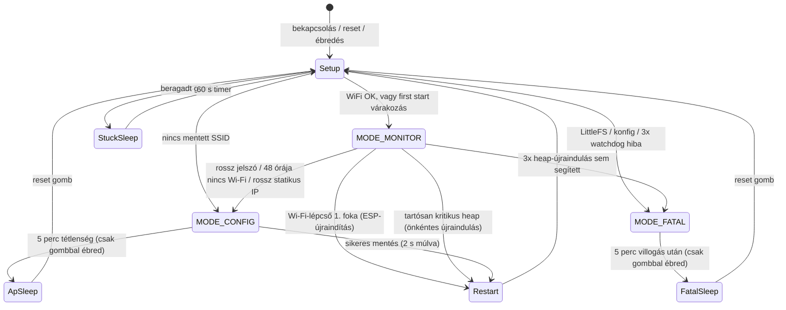
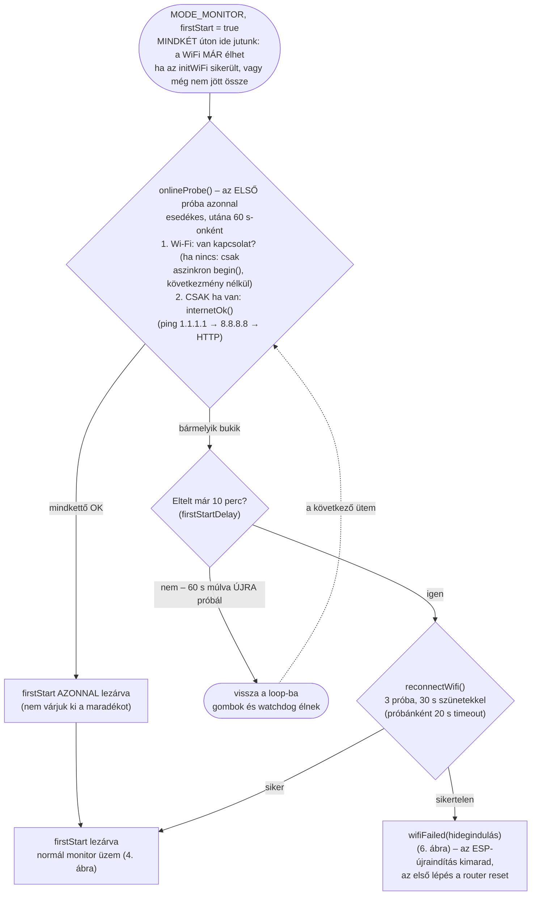
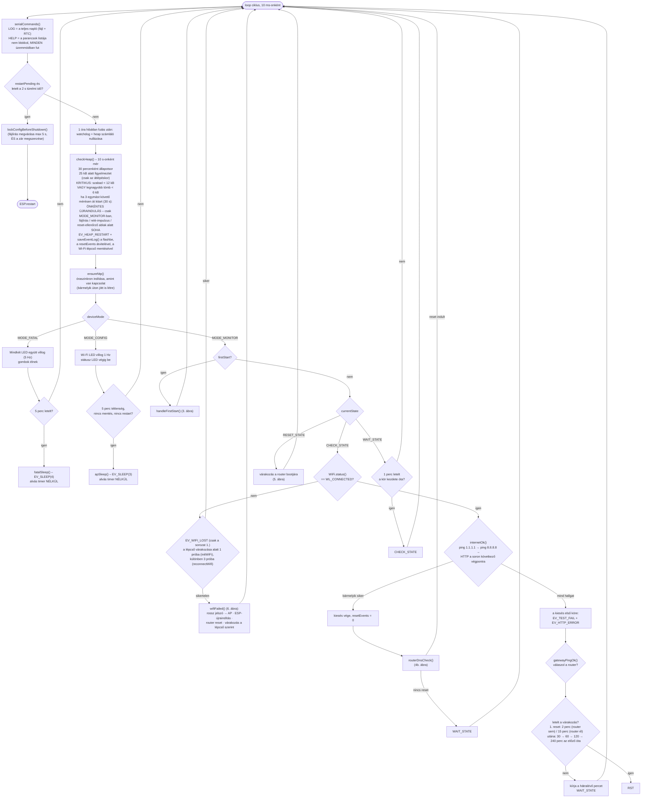
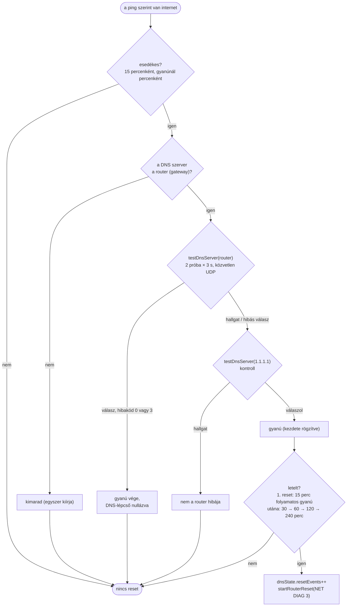
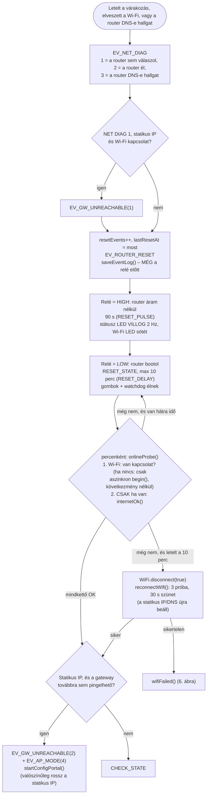
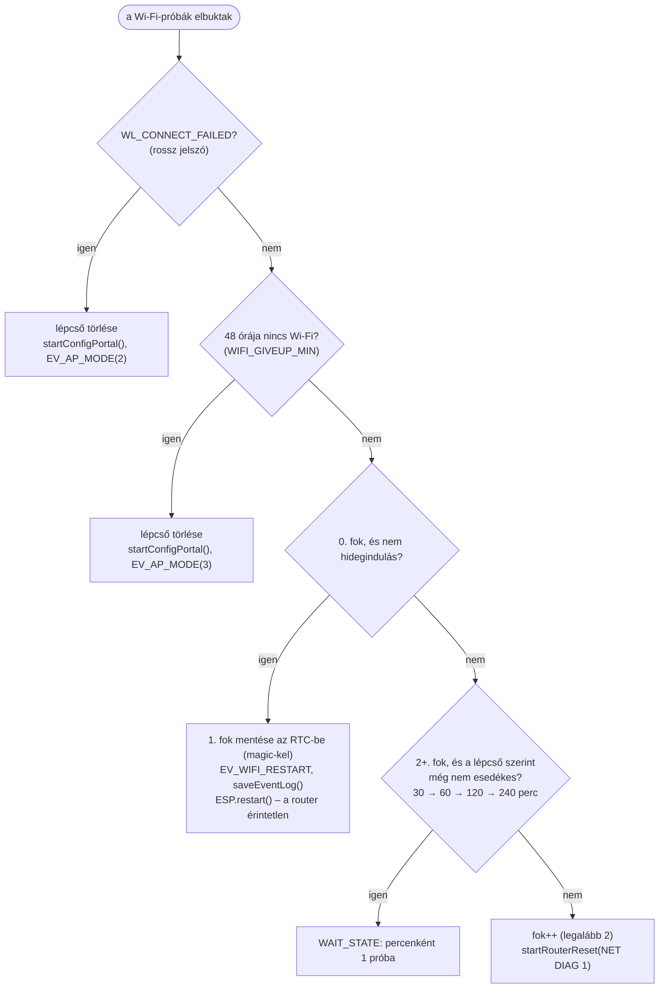
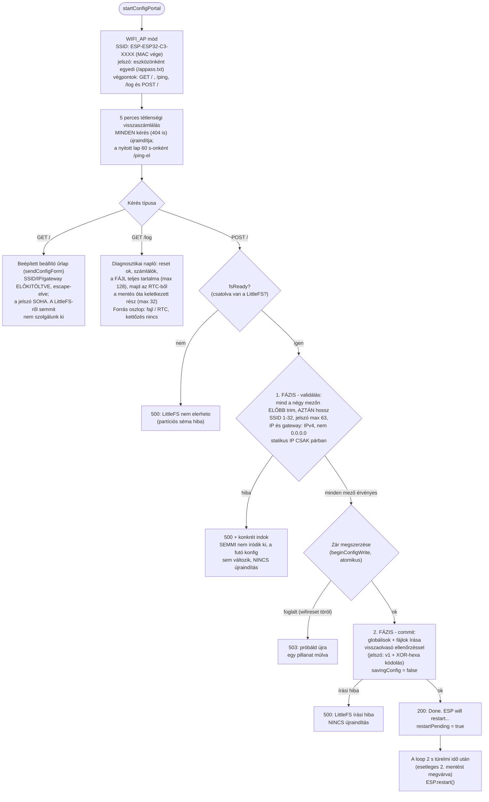
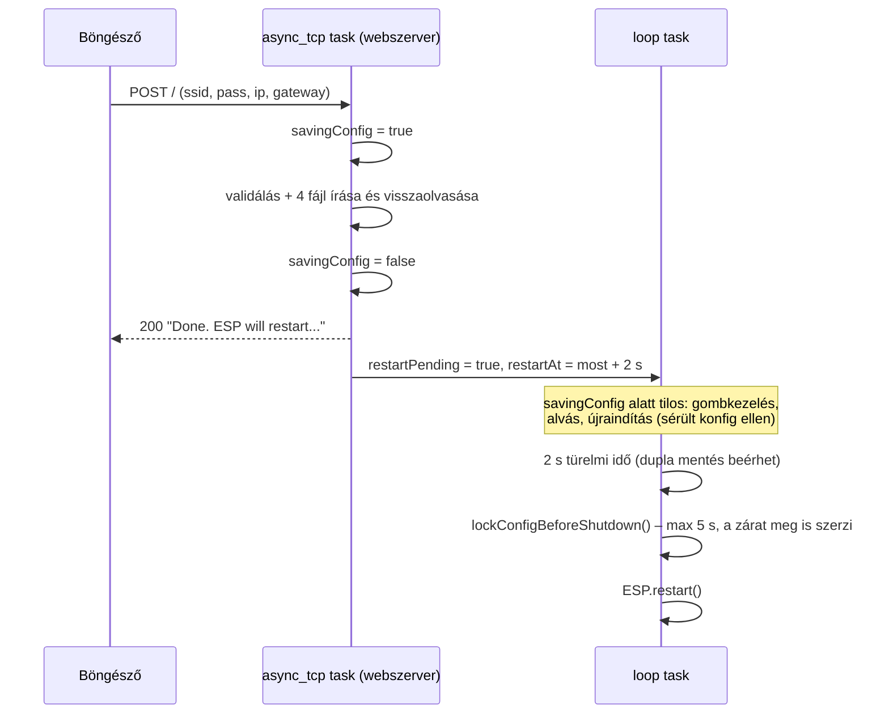
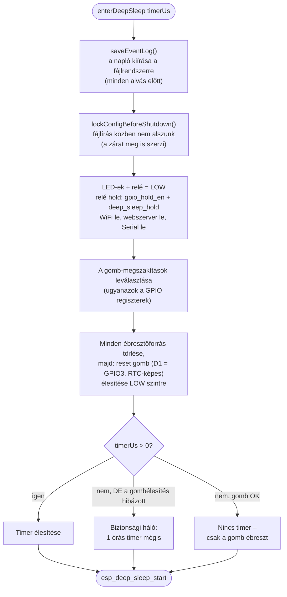

# Folyamatábrák

A firmware **jelenlegi** működésének pontos folyamatábrái, [Mermaid](https://mermaid.js.org/)
jelöléssel – a GitHub és a GitLab natívan rendereli, a forrás pedig a kóddal
együtt verziókezelhető és diff-elhető. Minden időzítés és feltétel a
`bazsi_router_reboot.ino` konstansaiból származik; a doboz-feliratok a tényleges
függvény- és konstansneveket használják, hogy az ábra a kódból ellenőrizhető
legyen.

Jelölés: lekerekített doboz = belépési/kilépési pont, rombusz = döntés,
téglalap = művelet. Az `EV_*` címkék a diagnosztikai napló eseménykódjai
(lásd `MUKODES.md` 15. fejezet). A `saveEventLog()` a naplót a LittleFS-re is
kiírja – **öt** fontos pillanatban: **router reset előtt**, **AP módba váltás
előtt**, **minden `enterDeepSleep()`-en át vezető alvás előtt** (egyetlen közös
ponton, a függvény elején), a **heap miatti** és a **Wi-Fi miatti** saját
újraindulás előtt;
így egy áramszünet sem viszi el. A mentés **hozzáfűz**, nem ír felül: a fájl
saját, 128 bejegyzéses gyűrű, az RTC napló 32-es gyűrűje pedig csak a legutóbbi
mentés óta eltelt időt őrzi. Egyetlen kivétel a beragadt gomb 60 mp-es alvása:
az a `setup()` elején, a `handleStuckButton()`-ból megy el, saját úton – ott a
LittleFS még csatolva sincs, tehát nem is volna mit írni.

---

## 1. Üzemmódok – madártávlat

Az eszköz minden ébredése teljes újraindulás (a deep sleep is), ezért a teljes
életciklus a `setup()`-ból indul. **Három** üzemmód van (`deviceMode`:
`MODE_MONITOR`, `MODE_CONFIG`, `MODE_FATAL`); alvásból mindig a `setup()`-ba
tér vissza.

---

## 2. `setup()` – indulási folyamat

```mermaid
flowchart TD
    PWR([Bekapcsolás / reset / ébredés]) --> PINS["GPIO-k beállítása<br>relé = LOW, státusz LED = HIGH<br>relé hold feloldása (gpio_hold_dis)"]
    PINS --> SER["Serial indítása<br>max 3 s várakozás + 0,5 s CDC-beállás"]
    SER --> WDT["initWatchdog()<br>TWDT: 90 s, trigger_panic = true<br>a loop task feliratkoztatva<br>innentől a setup() is felügyelt"]
    WDT --> STUCK{"Nyomva van valamelyik gomb?<br>reset (D1) vagy wifireset (D0) = LOW"}
    STUCK -->|igen| HOLD{"Elengedik 3 s-on belül?<br>(STUCK_BUTTON_CONFIRM_MS)<br>a gombos ébresztés alatt a gomb<br>MINDIG lenyomva találtatik"}
    HOLD -->|"igen – ez ébresztő gombnyomás volt"| BOOTLOG
    HOLD -->|"nem – tényleg beragadt"| SBLOG["EV_BOOT + EV_STUCK_BUTTON naplózása<br>(csak az első körben – az ismétlődő<br>60 s-os ébredések némák)"]
    SBLOG --> SBLINK["3 s: a két LED FELVÁLTVA villog"]
    SBLINK --> SB60["Deep sleep 60 s<br>csak timer ébresztés, gomb NEM<br>(boot loop ellen)"]
    SB60 --> PWR
    STUCK -->|nem| BOOTLOG["EV_BOOT naplózása"]
    BOOTLOG --> ARM0["armButtonLatches()<br>a gomb-megszakítások élesítése<br>(a beragadt-gomb ellenőrzés UTÁN)"]
    ARM0 --> WCHK{"checkWatchdogResets()<br>rendellenes reset volt?<br>(TASK_WDT / INT_WDT / PANIC / LOCKUP)"}
    WCHK -->|"igen, sorozatban a 3."| FATAL["enterFatal()<br>MODE_FATAL, EV_FATAL(3)"]
    WCHK -->|"nem, vagy még 3 alatt"| HC["initHeapState() + applyHeapCarry()<br>a heap-újraindulás átvitele: resetEvents (pontosan egyszer)<br>initWifiLadder(): a Wi-Fi-lépcső (magic-kel);<br>ha az 1. fokon áll, a first start kimarad"]
    FATAL --> HC
    HC --> FS{"initLittleFS()<br>begin(formatOnFail = true)<br>formázás: 128 szektor, 4-7 s"}
    FS -->|"csatolás sikertelen"| FATAL2["enterFatal()<br>EV_FATAL(1)"]
    FS -->|ok| CFG{"Konfig olvasása:<br>/ssid.txt /pass.txt /ip.txt /gateway.txt<br>(jelszó: v1 hexa dekódolás)"}
    CFG -->|"fájl létezik, de olvashatatlan"| FATAL3["enterFatal()<br>EV_FATAL(2)"]
    CFG -->|"ok vagy hiányzó fájl"| PERS["WiFi.persistent(false)"]
    FATAL2 --> PERS
    FATAL3 --> PERS
    PERS --> ISFATAL{MODE_FATAL?}
    ISFATAL -->|igen| TOLOOP([loop: hibajelzés])
    ISFATAL -->|nem| WIFI{"initWiFi()<br>statikus IP ha érvényes, különben DHCP<br>csatlakozás max 20 s"}
    WIFI -->|siker| MON["MODE_MONITOR<br>EV_WIFI_OK (param: a lépcső foka)<br>WiFi LED = HIGH"]
    WIFI -->|"ssid üres"| AP["startConfigPortal()<br>MODE_CONFIG, EV_AP_MODE(1)"]
    WIFI -->|"ssid van, de nem érhető el"| FIRST["MODE_MONITOR<br>first start várakozás indul<br>(3. ábra)"]
    MON --> TOLOOP2([loop: ELŐBB handleFirstStart 3. ábra,<br>utána az állapotgép])
    FIRST --> TOLOOP2
    AP --> TOLOOP3([loop: portál])
```

---

## 3. First start – türelmi idő induláskor

Áramszünet után a router lassabban bootol, mint az ESP; ezért mentett SSID
mellett az eszköz nem megy azonnal AP módba. A 10 perc **felső korlát**:
60 másodpercenként megnézzük, hogy visszajött-e a hálózat és az internet, és
ha mindkettő megvan, a várakozás azonnal véget ér.

---

## 4. `loop()` diszpécser és a monitor állapotgép

### Tartalék HTTP végpontok (sorban váltakoznak)

| # | Végpont | Elvárt válasz |
|:-:|---|---|
| 1 | `http://www.msftconnecttest.com/connecttest.txt` | `Microsoft Connect Test` |
| 2 | `http://cp.cloudflare.com/generate_204` | 204 No Content |
| 3 | `http://detectportal.firefox.com/success.txt` | `success` |
| 4 | `http://nmcheck.gnome.org/check_network_status.txt` | `NetworkManager is online` |
| 5 | `http://connectivitycheck.gstatic.com/generate_204` | 204 No Content |

### 4b. A router DNS-ének ellenőrzése (`routerDnsCheck()`)

---

## 5. Router reset (`startRouterReset()` és `RESET_STATE`)

---

## 6. `wifiFailed()` – a Wi-Fi-lépcső

A lépcső **30 perc stabil Wi-Fi után** nullázódik (`wifiConnectedTick()`). Az
áramszünet, a gombok, a mentés utáni újraindulás és minden alvás törli; a saját,
a heap miatti és a watchdog-újraindulást túléli (`RTC_NOINIT`).

---

## 7. AP beállító portál (MODE_CONFIG)

### A mentés két taskja (halasztott újraindítás)

---

## 8. Elalvás és ébredés

Minden alvás a közös `enterDeepSleep()`-en megy át:

| Alvás | Kiváltó ok | Napló | Timer | Reset gomb ébreszt? |
|---|---|---|:---:|:---:|
| `apSleep()` | AP portál 5 perc tétlenség | `EV_SLEEP(3)` | – | igen |
| `fatalSleep()` | végzetes hiba, 5 perc villogás után | `EV_SLEEP(4)` | – | igen |
| beragadt gomb\* | reset/wifireset LOW induláskor **és 3 s után is** | `EV_STUCK_BUTTON` | 60 s | **nem** (szándékosan) |

\* Ez az egyetlen alvás, ami **nem** az `enterDeepSleep()`-en megy át: a
`handleStuckButton()` a `setup()` elején, saját úton alszik el (nincs
`saveEventLog()` – a LittleFS ott még nincs csatolva; és szándékosan nem
armol gombébresztést, különben a beragadt gomb azonnal boot loopot okozna).

Ébredéskor az eszköz teljesen újraindul (`setup()`, 2. ábra); a RAM-beli
számlálók (`testState`, `timing`, `uiFlags`) nullázódnak. Ami az RTC
memóriában túléli:

| Változó | Tárolás | Mit él túl? |
|---|---|---|
| diagnosztikai napló (`rtcEvMagic`, `rtcEvNext`, `rtcEvents`) | `RTC_NOINIT` | deep sleep, watchdog reset, reset gomb – csak az áramtalanítás törli |
| `rtcSavedEvNext` (a legutóbbi fájlmentés pozíciója) | `RTC_NOINIT` | ugyanaz |
| watchdog számláló (`rtcWdtMagic`, `rtcWdtResets`) | `RTC_NOINIT` | ugyanaz |
| heap-újraindulások és az átvitel (`rtcHeapMagic`, `rtcHeapRestarts`, `rtcCarryResetEvents`) | `RTC_NOINIT` | ugyanaz |
| a Wi-Fi-lépcső (`rtcWifiMagic`, `rtcWifiStep`, `rtcWifiOutageMin`) | `RTC_NOINIT` | a saját, a heap miatti és a watchdog-újraindulást – az áramszünet, a gombok és az alvás törlik |

A **valós idő** (`gettimeofday()`) szintén túléli a deep sleepet – az RTC
órából jön –, míg a `millis()` minden ébredéskor nulláról indul.

---

*Az ábrák a `bazsi_router_reboot.ino` aktuális állapotát dokumentálják.
Módosításkor a kóddal együtt frissítendők – a viselkedést a `test/` alatti
370 forgatókönyves (2195 ellenőrzéses) tesztkészlet rögzíti.*
