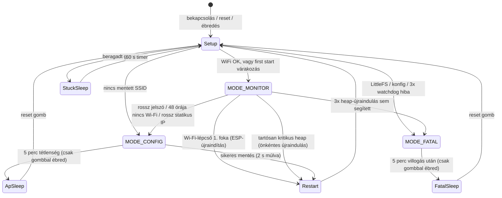
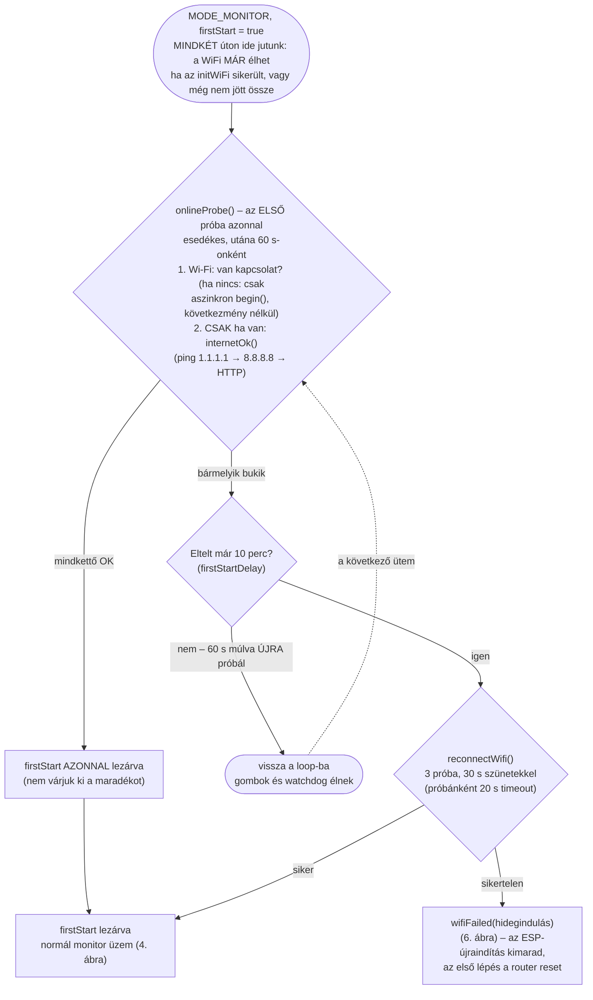
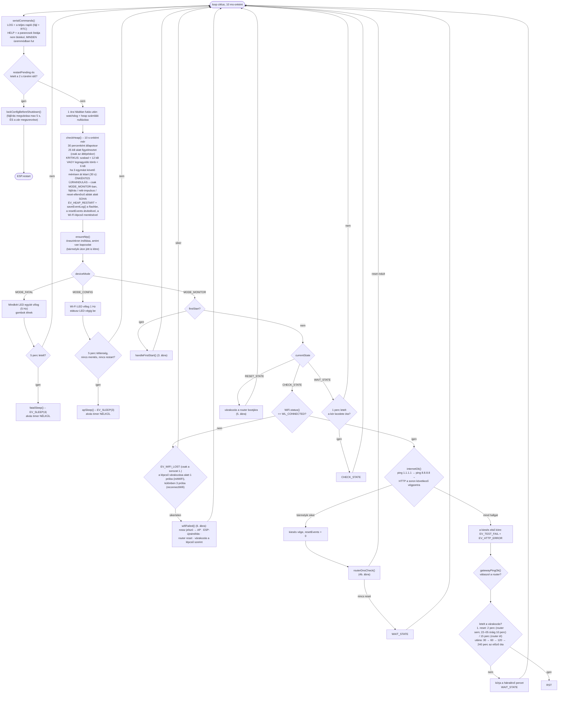
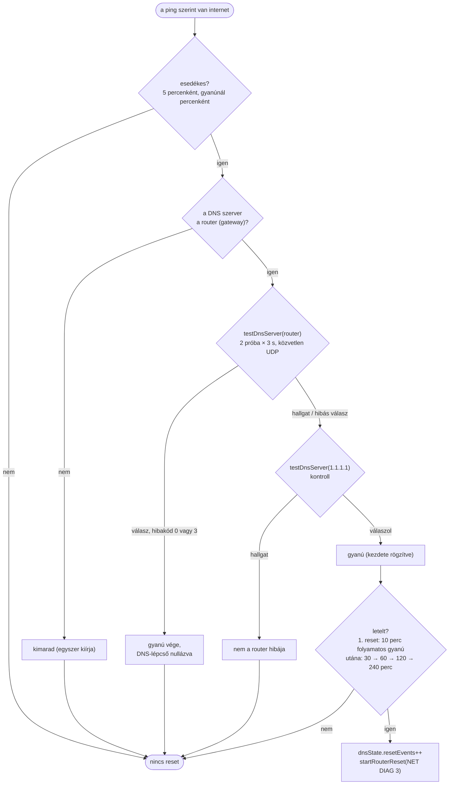
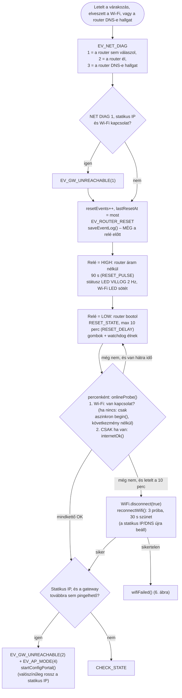
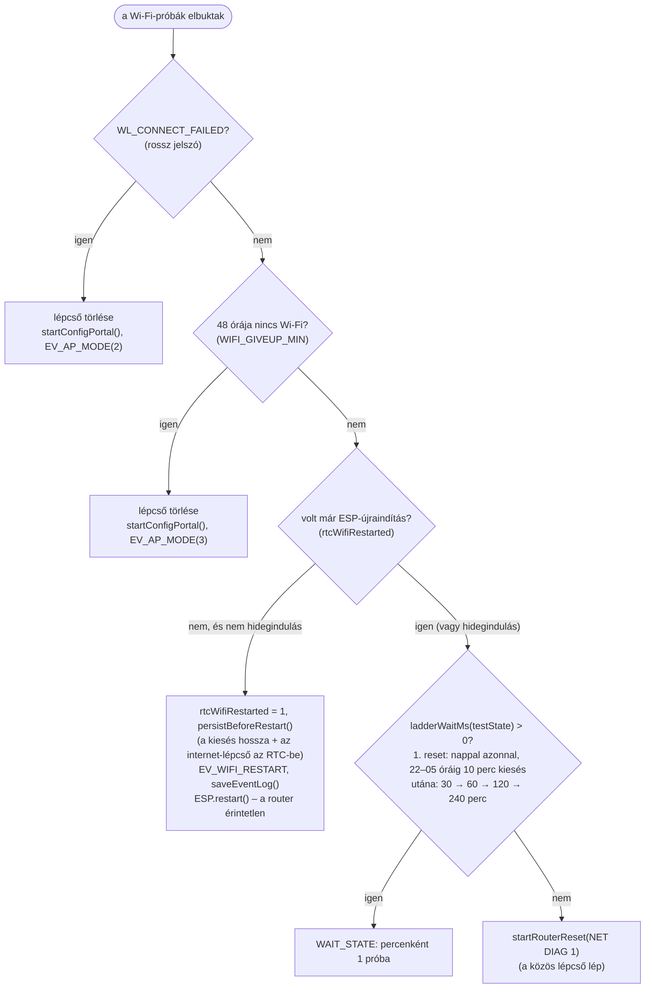
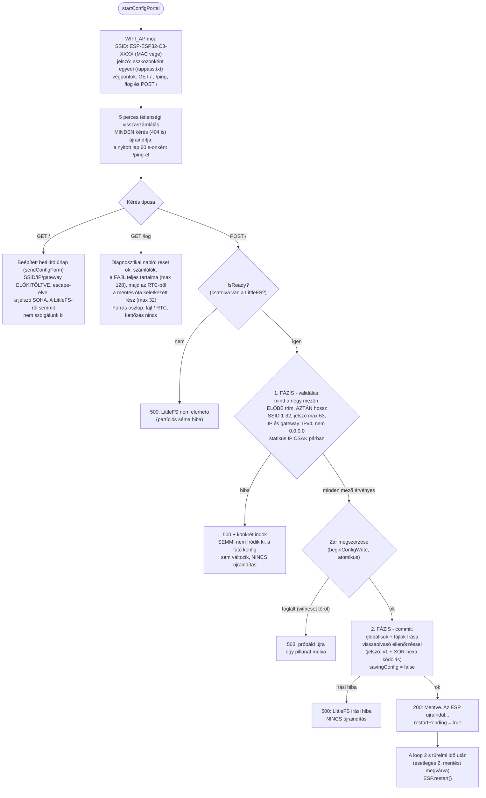
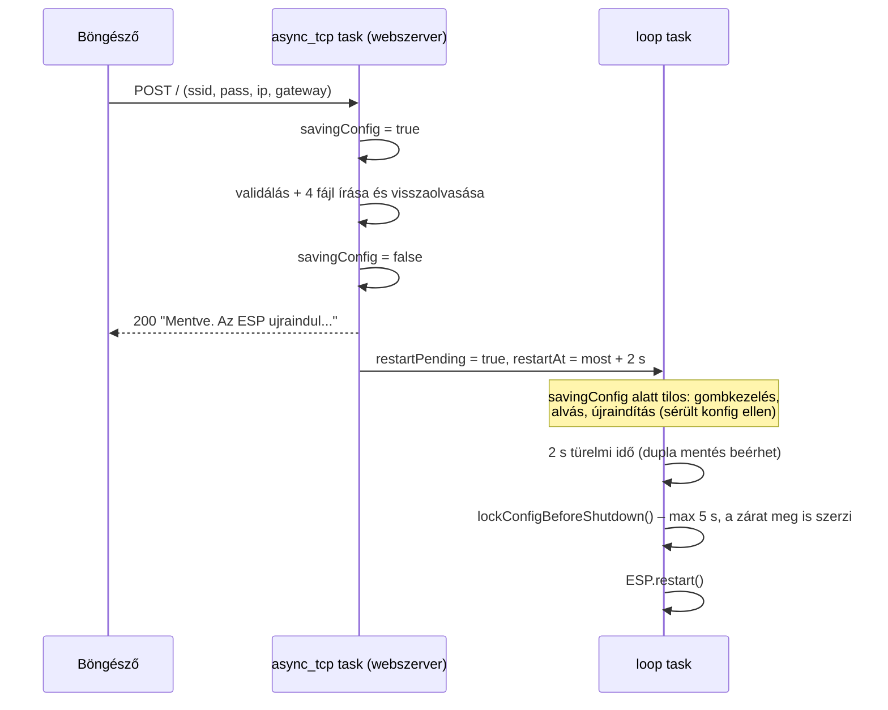
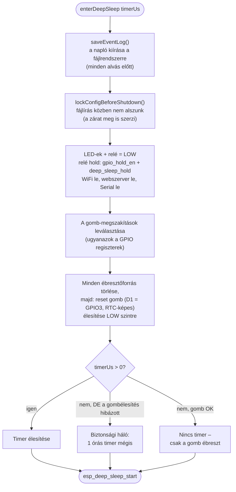

# Működés – a teljes leírás

Az eszköz teljes viselkedése: mikor mit csinál és meddig, a hardver, a
telepítés, a biztonság és a folyamatábrák. Minden érték a
`bazsi_router_reboot.ino` konstansaiból származik. Rövid változat:
[ATTEKINTES.md](ATTEKINTES.md); a tesztkészlet: [test/README.md](test/README.md).

---

## 1. Üzemmódok

Az eszköz mindig pontosan egy üzemmódban van.

| Üzemmód | Mikor | Mit csinál |
|---|---|---|
| `MODE_MONITOR` | Van Wi-Fi kapcsolat, vagy épp épül | Internetet tesztel, szükség esetén routert indít újra |
| `MODE_CONFIG` | Nincs használható Wi-Fi konfiguráció | AP beállító portál (`ESP-<chip>-XXXX`, eszközönként egyedi jelszó – a soros porton, `192.168.4.1`) |
| `MODE_FATAL` | A fájlrendszer nem használható, vagy 3 watchdog reset | Mindkét LED villog, semmi más nem fut |

---

## 2. Bekapcsolás → első kapcsolat

| Lépés | Időtartam | Következő |
|---|---|---|
| Kimenetek alapállapotba (relé `LOW`, státusz LED be, Wi-Fi LED ki) | azonnal | |
| Soros port indítása | max. **3 mp** + 0,5 mp | |
| **Watchdog bekapcsolása** | azonnal | Innentől a `setup()` maradéka is felügyelt – lásd 8. pont |
| Beragadt gomb ellenőrzés (**mindkettő**: `D0` és `D1`) | azonnal | Ha bármelyik nyomva: **3 mp türelem az elengedésre**, utána LED-ek **felváltva** villognak 3 mp-ig, majd **60 mp** deep sleep |
| Watchdog reset számláló ellenőrzés | azonnal | 3. rendellenes reset → `MODE_FATAL` |
| LittleFS csatolás (első indításkor **formázás**: 4–7 mp) | azonnal | Hiba → `MODE_FATAL` |
| Konfiguráció beolvasása | azonnal | Olvasási hiba → `MODE_FATAL` |
| Wi-Fi csatlakozás | max. **20 mp** | siker → `MODE_MONITOR` |

> A `MODE_FATAL` **nem állítja meg** a `setup()`-ot: az `enterFatal()` csak
> beállítja a módot és kiírja az okot, a `setup()` pedig végigfut (a Wi-Fi
> indítását már kihagyva), a jelzést utána a `loop()` végzi.

### Ha a csatlakozás nem sikerül

| Van mentett SSID? | Viselkedés |
|---|---|
| **Nincs** | Azonnal `MODE_CONFIG` |
| **Van** | **legfeljebb 10 perc** várakozás (`firstStartDelay`), majd **3 próba** (köztük 30 mp). A várakozás korábban véget ér, ha a percenkénti próbánál a hálózat **és** az internet is megvan – lásd lent |

A 3 próba után a **hiba oka** dönt:

| `WiFi.status()` | Jelentés | Következmény |
|---|---|---|
| `WL_CONNECT_FAILED` | hitelesítési hiba → rossz jelszó | **Azonnal AP mód** |
| bármi más | a hálózat nem látszik | a **Wi-Fi-lépcső** (5. fejezet) – hidegindulásnál az ESP-újraindítás kimarad, az első lépés a router reset |

### A mentés utáni első indulás

A beállító oldalon mentett adatokkal az első csatlakozás **próba**: ha nem
sikerül, a hiba szinte biztosan a beírt adatban van (elírt hálózatnév, 5 GHz-es
hálózat, rossz jelszó), nem a routerben. Ezért a mentés utáni újraindulás (az
ESP-é – a routerhez a mentés nem nyúl) így megy:

| Lépés | Viselkedés |
|---|---|
| Mentés | az újraindulás előtt egy jelző kerül az RTC memóriába (`rtcConfigProbe`, ellenőrző értékkel); csak ez az út állítja |
| Indulás | a jelzőt **azonnal felhasználja** (törli), és ehhez az induláshoz megjegyzi; a 10 perces türelmi idő kimarad, mert a mentés a routert nem kapcsolta le |
| Sikerül csatlakozni | a próba lezárul, innen **minden a megszokott szabályok szerint** megy (`CP2`) |
| Nem sikerül (a hálózat nem látszik, vagy rossz a jelszó) | induláskor 1 + utána 3 próba (mint figyelés közben), majd **a mentett Wi-Fi adatok törlődnek** (mint a wifireset gombnál), és az ESP **újraindul AP módba** – router reset nélkül (`AP MODE` 5; mérve 2,0 perc, `CP1`, `CP4`) |
| Az így indult AP mód | pontosan úgy viselkedik, mint az első indulásé: **5 perc tétlenség után alvás**, időzített ébresztés nélkül, a reset gomb ébreszti (`CP3`) |

Áramszünet, gombos újraindítás vagy bármely más újraindulás után nincs jelző
(`CP5`). Mivel a jelzőt az indulás azonnal törli, egy próba közbeni lefagyás
után is a megszokott szabályok élnek.

Az ESP32 core megkülönbözteti a kettőt (`STA.cpp`): `WIFI_REASON_NO_AP_FOUND` →
`WL_NO_SSID_AVAIL`, `WIFI_REASON_AUTH_FAIL` → `WL_CONNECT_FAILED`. Konzervatívan
döntünk: **csak** az explicit hitelesítési hiba küld AP módba, mert a téves
„várjunk tovább" ára késleltetett újrakonfigurálás, a téves „AP mód" ára viszont
egy halott eszköz. A rossz jelszót a core csak a 2. próbától jelzi (`R5`).

A 10 perces várakozás oka: áramszünet után az ESP másodpercek alatt elindul,
a router viszont percekig bootol. Hidegindulástól az első router resetig mérve
**12 perc** (`WF2`).

### Mekkora áramszünetet él túl felügyelet nélkül?

Teszttel kimérve (`PO1`–`PO3`):

| A router ennyi idő múlva áll fel | Eredmény |
|---|---|
| 8 perc | Kivárja a türelmi időben, csatlakozik |
| 11 perc | Az első 3 próba elkapja |
| 20 perc | A router reset utáni várakozás elkapja |
| ennél tovább | a Wi-Fi-lépcső: router reset 30 perc / 1 óra / 2 óra / 4 óra szünettel, közben percenként próba |
| **48 óránál tovább** | Feladja: AP mód, majd 5 perc után alvás |

**A hosszú várakozások percenkénti próbája** (`onlineProbe()`) két lépésből
áll, ebben a sorrendben:

1. **Wi-Fi – kísérlet, nem teszt.** Kapcsolat híján csak *kezdeményez* egyet
   (aszinkron `WiFi.begin()`, nem vár rá), és kilép. A kudarcnak **nincs
   következménye**: nem nő számláló, nem változik állapot.
2. **Internet – csak meglévő kapcsolat mellett.** Ugyanaz az ellenőrzés, mint
   normál üzemben (3. fejezet). Hálózat nélkül el sem indul.

A várakozás akkor zárul korábban, ha **mindkét lépés** sikerül. A próba
**ismétlődik**, tehát elég, ha a kapcsolat a várakozás *bármely* pontján
helyreáll (mérve: `OP7`).

---

### Áramszünet

Áramszünetkor az **ESP és a router együtt áll le**, és visszatéréskor együtt is
indul – csakhogy az ESP másodpercek alatt bootol, a router percek alatt. Ha az
ESP a saját mércéje szerint azonnal tesztelne, „nincs internet"-et látna, és
percekkel az áramszünet után elsőként azt tenné, amit épp nem szabad: elvenné a
routertől az áramot, pont bootolás közben.

Két dolog véd ez ellen:

1. a **10 perces türelmi idő** (`firstStartDelay`) **minden** hidegindulásnál,
2. és a **60 másodpercenkénti próba**, ami a türelmi időt lezárja, amint a
   router ténylegesen felállt – tehát a 10 perc nem elvesztegetett idő.

| helyzet | mért eredmény |
|---|---|
| a router 3 perc alatt feláll | az ESP 3 perc 21 mp-kor kezd tesztelni, a reléhez **hozzá sem nyúl** (`PWR1`) |
| a router egyáltalán nem áll fel | az első router-újraindítás **12 perckor** (`PWR2`) |

Ami az áramszünettel **elvész**: a diagnosztikai napló és minden RTC-számláló
(a watchdog-számláló tiszta lappal indul). Ez szándékos – az áramtalanítás
emberi beavatkozás, tehát tiszta lap. Ami **megmarad**: a LittleFS-en tárolt
Wi-Fi konfiguráció.

> A relé a bekapcsolás és a program indulása közti ablakban is `LOW` marad, mert
> a **22 kΩ lehúzó ellenállás** tartja – szoftver ilyenkor még nem fut. Enélkül
> egy áramszünet után a router nem is kapna áramot vissza.

---

## 3. Normál működés – az internet figyelése

| Állapot | Mit csinál | Meddig |
|---|---|---|
| `CHECK_STATE` | megnézi, van-e internet; kiesésnél a router pingjét is | ~1 mp (élő internet) – ~50 mp (halott DNS) |
| `WAIT_STATE` | vár a következő ellenőrzésig | a kör **kezdetétől** 1 perc (`CHECK_INTERVAL_MS`) |
| `RESET_STATE` | vár a router bootolására | legfeljebb 10 perc (`RESET_DELAY`) |

**Van internet**, ha az alábbiak közül bármelyik sikerül (a sor az első
sikernél megáll):

| # | Mit | Időtartam, ha nem sikerül |
|:-:|---|---|
| 1 | ping `1.1.1.1` (4 próbából 2 válasz kell) | ~5 mp |
| 2 | ping `8.8.8.8` | ~5 mp |
| 3 | HTTP teszt a soron következő végpontra (Microsoft, Cloudflare, Mozilla, GNOME, Google) | 15 mp (a szerver hallgat), 28–33 mp (halott DNS) |

A HTTP teszt csak akkor fut, ha mindkét ping hallgat – vagyis akkor, ha a
hálózat a pinget szűri. A 204-es végpontok captive portált sem fogadnak el.
Sikernél a soros portra csak a `Successful Test` kerül; eltéréskor a kapott
törzs és a `Hamis ertek!` is.

A tartalék HTTP teszt öt végpontja (mindig a soron következő jön):

| # | Végpont | Üzemeltető | Elvárt válasz |
|:-:|---|---|---|
| 1 | `msftconnecttest.com/connecttest.txt` | Microsoft | `Microsoft Connect Test` |
| 2 | `cp.cloudflare.com/generate_204` | Cloudflare | **204 No Content** |
| 3 | `detectportal.firefox.com/success.txt` | Mozilla | `success` |
| 4 | `nmcheck.gnome.org/check_network_status.txt` | GNOME | `NetworkManager is online` |
| 5 | `connectivitycheck.gstatic.com/generate_204` | Google | **204 No Content** |

Egy ping 4 próbából 2 választ követel (egy elveszett csomag nem kiesés). A
204-es ellenőrzés szigorúbb a szövegesnél: captive portál nem tud
`204 No Content`-et adni. A szöveges ellenőrzés legfeljebb 96 bájtot olvas, és
a `Transfer-Encoding: chunked` keretezést maga bontja le (a `HTTPClient` ezt
csak a `getString()` útján tenné, az viszont korlátlanul foglalna).

> **DNS-szűrő (Pi-hole, AdGuard):** ha egy végpontot tilt, csak az a HTTP teszt
> bukik; a döntést a két ping hozza, így ez téves resetet nem okoz.

---

## 4. Az internet kiesik – router újraindítás

Kiesésnél minden körben a router (gateway) pingje is lefut. Ez dönti el, mennyi
internet nélküli idő után jön a reset:

| `NET DIAG` | Helyzet | Reset |
|:---:|---|---|
| **1** | a router **sem** válaszol (vagy nincs Wi-Fi / gateway-cím) | **2 perc** után (`ROUTER_DOWN_WINDOW_MS`); 22:00–05:00 között **10 perc** (`QUIET_WINDOW_MS`) |
| **2** | a router válaszol, az internet nem | **15 perc** után (`WAN_DOWN_WINDOW_MS`) |

Ha a reset nem segített, a következő az előzőhöz képest **30 perc → 1 óra →
2 óra → 4 óra** múlva jön, onnan 4 óránként (`RETRY_BACKOFF_MS`). Egy sikeres
ellenőrzés mindent nulláz. Alvás ezen az ágon nincs: az eszköz végig figyel, és
naplózza, amikor visszajön az internet.

A Wi-Fi elvesztésére (3 próba után sincs kapcsolat) a Wi-Fi-lépcső felel
(5. szakasz): előbb az ESP indul újra, és csak ha az sem segít, jön a router
reset. Rossz jelszónál reset helyett AP mód.

**Éjszakai csendes időszak** (`QUIET_START_HOUR` = 22, `QUIET_END_HOUR` = 5,
helyi idő a `NTP_TZ` szerint): a router-hiba (`NET DIAG` 1) türelmi ideje
2 helyett 10 perc, és a Wi-Fi miatti első router reset is csak legalább 10 perc
kiesés után jön (`wifiFirstWindowMs()`), hogy egy éjszakai firmware-frissítést ne
szakítson félbe. A szolgáltatói hiba (15 perc), a DNS-ág és a lépcső többi foka
változatlan. Érvényes idő nélkül (áramszünet után, NTP előtt) a nappali szabály
él. Az időzónát a `setup()` maga állítja be (`applyTimezone()`), mert az
újraindulás után az NTP csak Wi-Fi-vel indulna, az óra viszont az RTC-ben
megmaradt; e nélkül éjjel UTC-ben számolna, és a napló időbélyegei is UTC-ben
jelennének meg.

### Mennyi idő alatt dönt? (mérve)

| Helyzet | Eredmény | Teszt |
|---|---|---|
| router hiba, az első hibás ellenőrzéstől a resetig | **150 mp** (halott DNS: 168 mp) | `R7` |
| 5, 10, 14 perces szolgáltatói kiesés | **0** reset | `RD2` |
| 6 órás szolgáltatói kiesés | **4** reset: 15 perc, majd +30 perc, +1 óra, +2 óra | `RD3` |
| egy napig halott router | **9** reset, köztük legalább 30 perc | `RD8` |
| a 2026-11-22-i terepi nap (élő internet, lassú HTTP) | **0** reset (a régi firmware: 4) | `RD4` |
| a hálózat a pinget szűri, a HTTP megy | **0** reset | `RD6` |
| a router pingre sosem válaszol, szolgáltatói kiesés | reset már ~2,5 perc után (a 15 helyett) | `RD5` |

### A reset menete

| Lépés | Időtartam |
|---|---|
| Relé **be** → router áramtalanítva, státusz LED **villog 2 Hz** | |
| Áramtalanítás | **90 mp** (`RESET_PULSE`) |
| Relé **ki** → router visszakap áramot | |
| Várakozás a bootra | **legfeljebb 10 perc**; percenként megnézi, visszajött-e a hálózat és az internet, és ha igen, azonnal véget ér |
| Wi-Fi újracsatlakozás (ha a várakozás nem ért véget korán) | 3 próba, köztük 30 mp |

### A router DNS-e

Ha a ping megy, 5 percenként (`DNS_CHECK_INTERVAL_MS`) egy DNS-kérdés megy
**közvetlenül a router 53-as portjára** (saját UDP-csomag: az lwIP
névfeloldása átváltana a tartalékra és gyorsítótárazna).

| Router DNS | Kontroll: `1.1.1.1` DNS | Mi történik |
|---|---|---|
| válaszol (hibakód 0 vagy 3) | – | rendben; a DNS-számláló nullázódik |
| hallgat (vagy SERVFAIL, REFUSED) | válaszol | **gyanú**: percenként újra kérdez; **10 perc** (`DNS_FAIL_WINDOW_MS`) után reset, `NET DIAG` 3 |
| hallgat | hallgat | nincs reset (nem a router hibája) |
| a DHCP nem a routert adja DNS-nek | – | az ellenőrzés kimarad (egyszer kiírja) |

Egy kérdés: 2 próba, 3 mp várakozás (`DNS_ATTEMPTS`, `DNS_TIMEOUT_MS`), tehát
legfeljebb 6 mp; a kontrollal együtt 12 mp. Ha a reset nem segít, a következő
30 perc → 1 óra → 2 óra → 4 óra múlva jön. Ennek **saját számlálója** van
(`dnsState.resetEvents`), mert a ping közben végig sikeres, és a fő lépcsőt
minden sikeres ping nullázza.

| Helyzet (mérve) | Eredmény | Teszt |
|---|---|---|
| a router DNS-e lefagy | reset legkésőbb ~16 perc múlva (legfeljebb 5 perc a felismerésig + 10 perc kitartás) | `DN1` |
| a külső DNS is hallgat | 0 reset | `DN2` |
| 9 perces DNS-zavar | 0 reset | `DN3` |
| a 11-22-i nap, a zavarok alatt a DNS is hallgat | 0 reset | `DN4` |
| egy napig rossz router-DNS | 8 reset, köztük legalább 30 perc | `DN5` |

**Nem veszi észre:** ha a router a gyorsítótárából még válaszol, de továbbítani
már nem tud.

### A terepi napló (2026-11-22) tanulsága

A régi firmware HTTP alapján döntött. Aznap nappal a HTTP válaszok 10–12 mp
után időtúllépéssel elmaradtak, miközben az internet működött (a felhasználó
böngészett): ez négy téves resetet adott. A ping ilyenkor válaszol, ezért az
új szabállyal nincs reset. A csak DNS-fagyást a fenti DNS-ellenőrzés fogja meg.

### Statikus IP: ha a saját gateway sem válaszol

Statikus IP mellett a Wi-Fi **társítás sikerülhet** úgy is, hogy IP szinten
nincs út sehová – jellemzően **elgépelt statikus IP** miatt, amit a router
újraindítása nem javít.

| | |
|---|---|
| A gateway válaszol | a fenti szabályok |
| Nem válaszol, **először** | router hiba: reset (`GW UNREACH` 1) |
| A reset után **sem** válaszol | **AP beállító mód**, hogy javítható legyen (`GW UNREACH` 2, `AP MODE` 4) |

> Ha a routered nem válaszol ICMP echóra, statikus IP mellett ez tévesen
> „elérhetetlen"-t ad – ilyen routernél használj DHCP-t.

### Ha az újracsatlakozás sem sikerül

A reset után 3 próba; ha egyik sem sikerül: a Wi-Fi-lépcső (5. fejezet).

---

## 5. Wi-Fi kapcsolat megszakad – a Wi-Fi-lépcső

Működés közben a kiesést a percenkénti ellenőrzés veszi észre (Wi-Fi LED **ki**,
a státusz LED marad **be**). Utána:

| Fok | Mikor | Mit csinál |
|:-:|---|---|
| 0 → 1 | 3 újracsatlakozási próba (köztük 30 mp) sem segít | **az ESP újraindítja magát**, a router érintetlen; utána nincs 10 perces türelmi idő |
| 1 → 2 | az újraindulás után ismét 3 próba sem segít | **router reset** (`NET DIAG` 1), legfeljebb 10 perc várakozás a bootra, utána 3 próba; 22:00–05:00 között csak legalább 10 perc kiesés után |
| 2 → 3 … | még mindig nincs Wi-Fi | **30 perc**, majd **1 óra**, **2 óra**, onnan **4 óránként** újabb router reset |
| – | **48 órája** nincs Wi-Fi (`WIFI_GIVEUP_MIN`) | **AP beállító mód** (`AP MODE` 3) |

- **Rossz jelszó** (`WL_CONNECT_FAILED`) bármelyik fokon: azonnal AP mód,
  újraindítás és reset nélkül.
- **A várakozás ébren történik**: közben percenként egy csatlakozási próba fut
  (nem három), és ha a Wi-Fi visszajön, azonnal folytatódik a figyelés.
- **Hidegindulásnál** (áramszünet után) a 0. fok kimarad: az ESP épp most indult.
- **Ha a kiesés már kapott router resetet** (pl. a router sem válaszolt, a reset
  után pedig nem jött vissza a Wi-Fi), az ESP ugyanúgy újraindul, de a lépcső
  onnan folytatódik: a következő reset az előző után 30 perccel (majd 1 / 2 /
  4 óra) jön, nem rögtön az újraindulás után (`WFL11`, `WFL12`; korábban ~15 perc volt).
- **Kiesés alatti saját hálózat** (ha a beállító oldalon be van kapcsolva):
  az ESP-újraindítás után (hidegindulásnál a türelmi idő után) az ESP AP+STA
  módba vált, és a router keresése mellett a saját hálózatát
  (`ESP-ESP32-C3-XXXX`, az eszközönkénti AP jelszóval) is fenntartja; rajta a
  csak olvasható állapotoldal a `192.168.4.1` címen érhető el. A Wi-Fi
  visszatérésekor leáll. A lépcsőn nem változtat (mérve: az AP 3,3 perccel a
  kiesés után jön fel, a router reset ugyanúgy 5,3 percnél; `OA4`).
- **Nullázás**: ha a Wi-Fi **30 percig** folyamatosan megvan (`WIFI_STABLE_MS`).
  Így egy instabil routernél a második kiesés már router resetet kap, nem újabb
  ESP-újraindítást (`WFL5`).

**Egy közös lépcső.** A Wi-Fi miatti router resetek ugyanazon a lépcsőn
lépnek, mint az internet-ág resetjei (`ResetLadder`, `ladderWaitMs()`; a DNS-ág
is ezt a szerkezetet használja, saját példánnyal). A Wi-Fi-ágnak csak két saját
adata van: megvolt-e már az ESP-újraindítás (`rtcWifiRestarted`), és mióta tart
a kiesés (`rtcWifiOutageMin`, a 48 órás határhoz). A „fok” ezekből számolódik
(`wifiLadderLevel()`: 0 = nincs kiesés, 1 = ESP-újraindítás, 2+ = utána N-1
router reset). Következmény: egy sikeres internet-ellenőrzés a Wi-Fi miatti
reseteket is nullázza – ahogy minden más resetet –, az ESP-újraindítás jelzője
viszont csak 30 perc stabil kapcsolat után törlődik.

**Mit őriz meg az újraindulás:** az újraindítás jelzőjét és a kiesés hosszát
(`RTC_NOINIT`, ellenőrző értékkel), az internet-lépcsőt pedig a szándékos
újraindulás előtti mentés viszi át (12. fejezet). Ez a saját és a heap miatti
újraindulást túléli; watchdog-újraindulás után a jelző megmarad, a lépcső
elölről indul. **Törli** az
áramszünet, a reset és a wifireset gomb, a mentés utáni újraindulás és minden
alvás – ezek emberi beavatkozások, tehát tiszta lap.

| Mérve | Eredmény | Teszt |
|---|---|---|
| az újraindítás után visszajön a Wi-Fi | nincs router reset, azonnal figyel | `WFL1` |
| a Wi-Fi elvesztésétől a router reset kezdetéig | **5,3 perc**; éjjel (22:00–05:00) **13,3 perc** | `WFL2`, `QH6` |
| tartós Wi-Fi-hiány | resetek 30 / 60 / 120 / 240 perc szünettel (+ a bootvárakozás), 48 óra után AP, alvás nélkül | `WFL3` |
| várakozás közben visszajön | legfeljebb 1 perc alatt észreveszi; percenként 1 próba | `WFL4` |

### Ha te magad áramtalanítod a routert

**Az eszköz ezt nem tudja megkülönböztetni attól, hogy a router lefagyott** – a
hálózat mindkét esetben ugyanúgy eltűnik.

| | mért érték |
|---|---|
| **Türelmi idő** a hálózat eltűnésétől az ESP saját router-resetjéig | **4,3 perc** (`PWR3`; közben az ESP egyszer újraindul); 22:00–05:00 között legalább 10 perc |
| Ha a router ezen belül visszajön | az ESP **hozzá sem nyúl** a reléhez, csendben visszacsatlakozik (`PWR4`) |

---

## 6. AP beállító mód

| Esemény | Időtartam |
|---|---|
| Portál elérhető: `192.168.4.1` | |
| Jelzés: **Wi-Fi LED villog 1 Hz**, státusz LED végig **be** | azonnal |
| Az űrlap előkitöltése | SSID, IP, gateway a mentett értékkel (HTML-escape-elve), a kiesés-AP kapcsoló a mentett állással; **a jelszó soha** |
| Kiesés-AP kapcsoló | jelölőnégyzet: „Wi-Fi-kiesés alatt saját hálózat az állapotoldallal”, **alapból ki**; `/outageap.txt` (`"1"`/`"0"`), a wifireset gomb nem törli; csak `0` vagy `1` fogadható el (`OA1`); olvashatatlan fájlnál egyszerűen ki, nem végzetes hiba (`OA2`) |
| A beállító űrlap forrása | a programba fordítva (`FORM_HEAD` / `FORM_TAIL` + `sendConfigForm()`), nincs feltöltendő `data/` mappa – a portál a LittleFS-ről semmit nem szolgál ki |
| Tétlenség után deep sleep | **5 perc** (`AP_TIMEOUT_MS`) az utolsó kéréstől |
| A nyitva lévő lap keep-alive-ja | **60 mp**-enként `GET /ping` (1 bájt válasz) |
| Elfogadott IP / gateway | **csak IPv4**, nem `0.0.0.0`, és csak együtt |
| SSID / jelszó | mentéskor a szélső szóközök levágódnak; **az üres jelszómező a mentett jelszót megtartja**, üres jelszót csak a „Nyílt hálózat” jelölő ment (jelszóval együtt bejelölve: hiba) (`X2`, `X2b`) |
| Az oldalak nyelve | magyar (ékezet nélkül): űrlap, gomb („Mentes”), mentés utáni és hibaüzenetek, 404 |
| A jelszó tárolása | összekeverve (`v1:` + hexa), az eFuse MAC-hez kötve |
| Az alvásból ébredés | **csak a reset gombbal** – időzített ébresztés nincs |

Négy védelem óvja a mentést:

- **Amíg a lap nyitva van, nem alszik el.** A beállító oldal (és a naplóoldal)
  60 mp-enként meghívja a `/ping` végpontot, ami újraindítja az 5 perces
  visszaszámlálást. Enélkül az óra a *lapbetöltéstől* ketyegne, nem az utolsó
  interakciótól – mérve: 6 percnyi lassú gépelés után a Submit már nem érte el
  az eszközt. Applikációváltás után visszatérve a `visibilitychange` azonnal is
  jelez, nem kell a következő 60 mp-es ütemre várni.

- **Minden HTTP kérés újraindítja az 5 perces visszaszámlálást** – a 404-es
  válasszal végződő is, mert az is interakció. A határidő **abszolút**: mindig
  pontosan 5 perccel a *legutolsó* kérés utánra kerül, nem halmozódik. Felső
  korlát nincs: amíg nézegeted az oldalt, az eszköz ébren marad.
- **Fájlírás közben az eszköz soha nem alszik el** (a leállási út a zárat meg
  is szerzi, nem csak megvárja az írást), tehát nem maradhat félig
  kiírt konfiguráció.
- **Fájlírás közben a gombok sem indítanak újra.** A mentést az aszinkron
  webszerver taskja végzi, a gombokat viszont a `loop()` figyeli – egy éppen
  odaeső gombnyomás félbeszakított írást (a wifireset esetén ráadásul egyidejű
  törlést) okozna. A gombok a mentés befejeztével működnek tovább.
- **A sikeres mentés utáni újraindítás is megvárja az írást.** A 2 mp-es
  türelmi idő alatt újabb mentés érkezhet – mobilon a dupla koppintás gyakori –,
  és az újraindítás félbe vágná. Ugyanez igaz **minden alvásra**: az
  `enterDeepSleep()` egyetlen torlópont, amin minden alvás áthalad.

A várakozás **korlátos** (5 mp): ha a jelző bármiért beragadna, az eszköz nem
fagyhat le miatta – továbblép, és a soros porton szól róla.

Sikeres mentés után: válasz elküldése, **2 mp** türelmi idő, majd újraindulás.
A mentés **két fázisú**: előbb minden mező validálódik, és fájl csak akkor
íródik, ha mindegyik érvényes. Sikertelen validálásnál HTTP 500 és **nincs**
újraindulás – sem a fájlok, sem a futó konfiguráció nem változik, a beírt
adatok az űrlapon maradnak. Ha a konfigfájlokat épp más írja (wifireset gombos
törlés), a mentés HTTP 503-mal hátrál.

---

## 7. Végzetes hiba – `MODE_FATAL`

| Kiváltó ok | Napló |
|---|:---:|
| A LittleFS nem csatolható | `FATAL` 1 |
| A konfigurációs fájl létezik, de nem olvasható | `FATAL` 2 |
| 3 watchdog/panic miatti újraindulás | `FATAL` 3 |
| **A wifireset gomb nem tudta törölni a mentett adatokat** | `FATAL` 4 |

> A **hiányzó vagy üres** konfiguráció **nem** végzetes hiba – az első indítás
> és a wifireset gomb utáni állapot is ilyen. Ilyenkor AP mód indul.

Mind a négy ok ugyanaz a hibaosztály: **a fájlrendszer nem használható**, tehát
a konfiguráció sem betölteni, sem menteni nem lehet. Ilyen állapotban az eszköz
nem fut tovább – az újraindítgatás csak elfedné a hibát.

| Viselkedés | Érték |
|---|---|
| Mindkét LED együtt villog | **100 ms be / 100 ms ki** (`FATAL_BLINK_MS`, 5 Hz) |
| Relé | `LOW` – a router végig kap áramot |
| Állapotgép | nem fut |
| Gombok | a reset gomb mindig; a wifireset a 4-es oknál nem (lásd lent) |
| Deep sleep | **5 perc** után (`FATAL_SLEEP_AFTER_MS`) |
| Ébredés | **csak a reset gombbal** vagy áramtalanítással |

### A fájlműveletek hibái

A beállítások LittleFS-en tárolódnak, ezért minden fájlművelet hibája
kezelve van – és ami fontosabb, **egyik sem hazudik sikert**.

| Hiba | Viselkedés |
|---|---|
| A mentés félbeszakad (megtelt / haldokló flash) | A **régi érték is odavész**: a `FILE_WRITE` már a megnyitáskor csonkol, tehát mire kiderül, hogy az írás nem fér ki, a korábbi tartalom nincs meg. A válasz 500, az eszköz **nem indul újra**, és a következő induláskor üres SSID-vel **AP módba** kerül, ahol újra beállítható (mérve: `FS14`) |
| A fájlrendszer nem csatolható | Konkrét ok kiírása (a `begin()` csak `ESP_FAIL`-nél formáz, hiányzó partíciónál nem), majd végzetes hibajelzés – lásd fent |
| Hiányzó konfigurációs fájl | `CONFIG_MISSING` – nem hiba, AP beállító portál |
| A fájl nem nyitható írásra | `writeConfigValue()` `false`-t ad, a mentés nem történik meg |
| Rövid írás (megtelt FS) | A `print()` visszatérési értéke ellenőrizve, `false` |
| Az írás „sikerült", de a tartalom hibás | **Visszaolvasásos ellenőrzés** fogja meg |
| A törlés (csonkolás) nem megy | Tartalék: a fájl törlése `remove()`-val |
| Mentés a beállító oldalról | Két fázisú: fájl csak akkor íródik, ha **minden** mező érvényes. Hiba esetén HTTP 500 magyarázattal és **nincs újraindítás** |
| Érvénytelen űrlapadat (rossz SSID hossz, IP formátum, hiányzó SSID) | HTTP 500 az ok megnevezésével; **semmi nem íródik ki**, a futó konfiguráció sem változik |
| Mentés, miközben a wifireset gomb épp töröl | HTTP 503, a mentés nem ír bele a törlésbe (atomikus zár) |

A visszaolvasás azért kell, mert a `File::close()` és a `File::flush()` is
`void` a core-ban – a lezáráskor jelentkező hibát másképp nem lehetne észlelni.

A beállító oldalról mentés hibája korábban a legkellemetlenebb módon jelent
volna meg: az eszköz sikert válaszol, újraindul, és mivel nem mentett semmit,
ismét AP módban jön fel – a felhasználó pedig végtelen körben próbálkozik
magyarázat nélkül. Most a hibát megkapja, és az eszköz nem indul újra, tehát a
beírt adatok sem vesznek el.

### Hol keletkezik a jelzés

A 4-es ok annyiban különbözik, hogy a gombkezelőből jön, ami **blokkoló
ciklusokból is futhat** (a `waitWithButtons(RESET_DELAY)` például 10 percig nem
ad vissza a `loop()`-nak). Ha csak beállítanánk a módot, az eszköz addig tovább
működne – tesztelne, relét kapcsolna. Ezért a jelzés ott helyben, blokkolva
történik, és soha nem tér vissza. Kívülről nézve a viselkedés azonos.

---

## 8. Watchdog

| Paraméter | Érték |
|---|---|
| Timeout | **90 mp** |
| Élesedés | a soros port beállása után **azonnal**, a gombellenőrzés és a LittleFS csatolása **előtt** |
| Etetés nélküli leghosszabb `setup()`-szakasz | a LittleFS formázása: 4–7 mp (rossz esetben ~51 mp), 512 KiB = 128 szektor |
| Leghosszabb etetés nélküli szakasz (mérve) | **33 mp** (egy halott DNS-be futó HTTP kérés; hallgató szerver mellett 15 mp) |
| Etetés a hosszú várakozások alatt | ~10 ms-onként |
| Timeoutkor | panic → újraindulás |
| 3 rendellenes újraindulás után | `MODE_FATAL` |
| A számláló nullázódik | áramtalanításkor, vagy **1 óra** hibátlan működés után – **minden üzemmódban**, az AP portált és a first start várakozást is beleértve (mérve: `WDT9`) |
| Az „1 óra" mihez képest | a **mostani indulás** kezdetéhez (`timing.startMillis`), nem abszolút `millis()` értékhez (`WDT14`, `WDT15`) |

Az utolsó sor apróságnak tűnik, de ez volt a program **egyetlen abszolút
`millis()` összehasonlítása** – a másik 23 időzítés mind különbség-alakú. Két
hallgatólagos feltevést hordozott: hogy a `millis()` minden induláskor nulláról
kezd (ez igaz, lásd a 15. fejezet uptime-megjegyzését), és hogy nem fordul körbe
(ez 49,7 napig igaz). A különbség-alak mindkettőtől függetlenné teszi, és a
`timing.startMillis` maga mondja ki, mihez mérünk.

> Ezért a `timing.startMillis` mezőt a `firstStart` lezárása után **sem
> frissítjük**: végig a boot időbélyege marad. Egy frissítés eltolná a
> watchdog-ablakot.

Rendellenesnek számít: `ESP_RST_TASK_WDT`, `ESP_RST_INT_WDT`, `ESP_RST_WDT`,
`ESP_RST_PANIC`, `ESP_RST_CPU_LOCKUP`.

### Miért kell külön beállítani

Ha a program megakadna (végtelen ciklus, deadlock), a legrosszabb eset az, hogy
**a relé bekapcsolt állapotban ragad, és a router tartósan áram nélkül marad**.
A watchdog ezt oldja meg: újraindítja az ESP-t, a `setup()` pedig azonnal
`LOW`-ra állítja a relét, tehát a router visszakapja az áramot.

Az ESP-IDF task watchdogja alapból fut, de önmagában **nem véd meg**:

| | Érték a kész Arduino libekben | Következmény |
|---|---|---|
| `loopTaskWDTEnabled` | `false` (Arduino `main.cpp:111`) | a `loop()` megakadását észre sem veszi |
| `ESP_TASK_WDT_PANIC` | `y` (`defconfig.common:21`) – az IDF saját alapja `n` | jó, de nem a mi érdemünk: egy másképp fordított libnél a timeout csak figyelmeztetés lenne |
| `ESP_TASK_WDT_TIMEOUT_S` | `5` (IDF alap, a lib-builder nem írja felül) | rövidebb, mint a firmware szándékos blokkolásai |

> A „kész Arduino libek" értékei az
> [espressif/esp32-arduino-lib-builder](https://github.com/espressif/esp32-arduino-lib-builder)
> `configs/defconfig.common` és `configs/defconfig.esp32c3` fájljaiból valók –
> ezekből fordulnak az `esp32-arduino-libs` előfordított könyvtárak. Ami ott
> nem szerepel, arra az ESP-IDF Kconfig alapértelmezése érvényes.

Ezért az `initWatchdog()` mindhármat kifejezetten beállítja:

- **90 másodperces** timeout – a leghosszabb *nem etethető* blokkolás a
  `http.GET()`. A rossz eset nem a hallgató szerver (5 mp connect + 10 mp
  válasz = 15 mp), hanem a **halott DNS**, mert a névfeloldás a connect
  timeouton **kívül** esik – lásd lentebb
- **`trigger_panic = true`** – timeoutkor valódi újraindulás
- **`idle_core_mask = 0`** – csak a saját loop taskot figyeli. Az idle task
  figyelése itt káros lenne, mert a firmware szándékosan blokkol percekig
- a hosszú várakozások (`waitWithButtons`, `blockingDelay`, a 90 mp-es relé
  pulzus, az újracsatlakozás) **etetik** a watchdogot ~10 ms-onként

> A TWDT timeoutja globális, ezért az AsyncTCP saját taskjának figyelése is
> 5 mp-ről 90 mp-re lazul (`CONFIG_ASYNC_TCP_USE_WDT=1`, `AsyncTCP.cpp:334`).
> Ez a gyakorlatban nem számít: az aszinkron szerver kérései (az AP portál és
> a normál üzemű állapotoldal) ezredmásodpercek alatt lefutnak.

#### Mikor élesedik

A watchdog **a soros port beállása után azonnal** élesedik, még a
gombellenőrzés és a LittleFS csatolása előtt – vagyis a `setup()` gyakorlatilag
teljes egészében felügyelet alatt van:

| Szakasz | Felügyelve? | Megjegyzés |
|---|:---:|---|
| `pinMode`-ok, relé hold feloldása, `Serial.begin()` + max. 3 mp várakozás | nem | ide még nem megy ki soros üzenet, tehát az `initWatchdog()` hibajelzése is elveszne |
| gombellenőrzés, `checkWatchdogResets()` | **igen** | 3 mp türelem az elengedésre, aztán 3 mp villogás és deep sleep |
| LittleFS csatolás / **formázás** | **igen** | lásd lent |
| konfiguráció beolvasása | **igen** | öt rövid fájl |
| `WiFi.persistent()`, `initWiFi()`, AP portál indítása | **igen** | a Wi-Fi init a legvalószínűbb lefagyási pont; a 20 mp-es várakozás magától etet |
| `loop()` | **igen** | a core minden `loop()` körben etet (`loopTaskWDTEnabled`) |

> **Miért fér bele a formázás?** A `LittleFS.begin(true)` első indításkor
> formáz, etetés nélkül. A `partitions_custom.csv` 512 KiB-os partíciója
> **128 szektor**: tipikusan 30–50 ms/szektor, azaz **4–7 mp**, és még a
> szélsőségesen lassú, 400 ms/szektoros esetben is **~51 mp** – mindkettő a
> 90 mp-es `WDT_TIMEOUT_MS` alatt marad. A korábbi, ~1,5 MB-os sémánál ez
> 15–20 mp volt tipikusan, de a rossz esetben **153 mp**, azaz a timeout
> fölött – **ezért volt ott indokolt kihagyni a formázást a felügyeletből, és
> ezért fér bele most.** A kisebb partíció tette lehetővé ezt a változtatást.

#### Mit fog el a hardver magától

Az ESP32-C3 watchdogjai mind hardveresek (`SOC_WDT_SUPPORTED`):

| Watchdog | Állapot az Arduino buildben | Mit fog el |
|---|---|---|
| **INT_WDT** (interrupt) | **bekapcsolva, 300 ms** – `CONFIG_ESP_INT_WDT_TIMEOUT_MS=300` (`defconfig.common:17`); magát a `CONFIG_ESP_INT_WDT`-t a lib-builder sehol nem tiltja le, tehát marad az IDF `default y` | ha a FreeRTOS tick megáll: letiltott megszakítás, végtelen ciklus megszakításban |
| **TWDT** (task) | bekapcsolva (`ESP_TASK_WDT_EN`/`_INIT` IDF alap `y`), 5 mp, panic **`y`** (`defconfig.common:21`); az idle task nincs figyelve (`# CONFIG_ESP_TASK_WDT_CHECK_IDLE_TASK_CPU0 is not set`, `defconfig.esp32c3:2`) | egy figyelt task nem etet – ezt konfiguráljuk 90 mp-re |
| **RWDT** (RTC) | bootloader, 9000 ms | **csak a bootot** – az IDF `app_main()` előtt kikapcsolja (`BOOTLOADER_WDT_DISABLE_IN_USER_CODE` alapból `n`) |

Az INT_WDT és a TWDT megléte **fordítási idejű** (sdkconfig) döntés: ezek a
beállítások az előfordított `esp32-arduino-libs` könyvtárakba vannak beleégetve.
Vázlatból nincs API, amivel az INT_WDT-t be lehetne kapcsolni – ha ki lenne
kapcsolva, csak saját IDF-fordítás vagy az `esp32-arduino-lib-builder`
segítene. A TWDT-ből ezzel szemben van futásidejű API (`esp_task_wdt_*`), és a
firmware ezt használja is.

##### Miért 90 mp, és nem 30

A `NetworkClient::connect(host, port, timeout)` **először** névfeloldást végez,
és az `http.setConnectTimeout()` erre **nem vonatkozik**:

```cpp
int NetworkClient::connect(const char *host, uint16_t port, int32_t timeout_ms) {
  IPAddress srv((uint32_t)0);
  if (Network.hostByName(host, srv) != 1) {   // <- nincs timeout paraméter
    return 0;
  }
  return connect(srv, port, timeout_ms);
}
```

Egy lwIP DNS lekérdezés **szerverenként ~7 mp** alatt adja fel: `DNS_MAX_RETRIES`
= 4 (lwIP `opt.h`), `DNS_TMR_INTERVAL` = 1000 ms (`dns.h`), és a `dns_check_entry()`
a `tmr`-t 1, 1, 2, 3 lépésekben növeli – összesen 7 tick. DHCP-től jellemzően
2 szerver jön (a 3. slot a fallback, `LWIP_FALLBACK_DNS_SERVER_SUPPORT` alapból `n`).

Ha az eszköznek van **globális IPv6 címe** (a lib-builder `CONFIG_LWIP_IPV6_AUTOCONFIG=y`),
a `hostByName()` **kétszer** kérdez: előbb csak `AF_INET6`-ot, aztán `AF_UNSPEC`-et.

A 3.3.x core-ban ráadásul a sikertelen névfeloldás után még egy `0.0.0.0`-ra
irányuló `connect()` is lefutott a maga 5 másodpercével (a `lwip_getaddrinfo()`
pozitív hibakódját a `!hostByName()` nem vette észre). A 4.0.0 ezt javította
(`NetworkClient::connect()`: `hostByName(...) != 1` → azonnali kilépés), így ott
a legrosszabb eset ~28 mp.

| eset | egy bukott HTTP teszt |
|---|---|
| szerver hallgat, DNS jó | 15 mp |
| 1 DNS szerver, nincs IPv6 | ~12 mp |
| 2 DNS szerver, nincs IPv6 | ~19 mp |
| 2 DNS szerver + globális IPv6 | ~28 mp (4.0.0), **~33 mp** (3.3.x) |

A 90 mp tehát legalább ~2,7-szeres tartalékot ad. A `WD13` teszt a 33 mp-es
legrosszabb esetet méri.

A „kemény" megállást tehát az INT_WDT 300 ms alatt elkapja, akkor is, ha a
task watchdog még nem élesedett. Amit **csak** a task watchdog lát, az a
csendes, szabályosan blokkoló beragadás – amikor a rendszer tovább tickel, de
a mi taskunk örökre vár valamire. Épp ezért kellett a Wi-Fi init elé.

#### A feliratkozás ellenőrzése

Az `enableLoopWDT()` a core-ban **`void`** (`esp32-hal-misc.c`): ha az
`esp_task_wdt_add()` hibázik, csak egy belső `log_e()` jelzi, a visszatérési
értékből semmi. Ez akkor fordulhat elő, ha a TWDT nincs inicializálva
(`ESP_TASK_WDT_INIT=n`) – ilyenkor az `add()` `ESP_ERR_INVALID_STATE`-et ad.

Ezért az `initWatchdog()`:

1. ha kell, maga hívja az `esp_task_wdt_init()`-et (figyelt task nélkül ez még
   nem indítja el a timert),
2. **utána** iratkozik fel – ez a sorrend azért kell, mert az
   `esp_task_wdt_reconfigure()` csak nem üres tasklistánál indítja újra a
   timert (`task_wdt.c:595`),
3. végül `esp_task_wdt_status(NULL)`-lal **visszakérdezi**, hogy a `loop()`
   tényleg figyelve van-e.

Csak ha ez igaz, írja ki, hogy `Watchdog enabled`. Ha nem, egyértelmű
figyelmeztetést ad, és **nem etet**: feliratkozás nélkül minden
`feedLoopWDT()` `ESP_ERR_NOT_FOUND`-ot kapna, amire a core `log_e()`-t hív –
mérve **100 hibasor percenként** normál működésben, védelem nélkül.

#### Ismétlődő watchdog újraindulás

Ha a program ismételten megakad, az újraindítgatás önmagában nem megoldás.
**3 watchdog/panic miatti újraindulás után** az eszköz ugyanúgy leáll, mint a
többi végzetes hibánál: mindkét LED villog, 5 perc után deep sleep, és **csak a
reset gomb ébreszti**.

- A számláló `RTC_NOINIT_ATTR`-ben van, mert az `RTC_DATA_ATTR`-t egy watchdog
  reset újrainicializálná, azaz épp azt veszítenénk el, amit számolni akarunk.
- Rendellenesnek számít: `ESP_RST_TASK_WDT`, `ESP_RST_INT_WDT`, `ESP_RST_WDT`,
  `ESP_RST_PANIC`, `ESP_RST_CPU_LOCKUP`.
- **Áramtalanítás** vagy külső reset nullázza (emberi beavatkozás → tiszta lap).
- **1 óra hibátlan működés** szintén nullázza.

Az **interrupt watchdog** (`ESP_INT_WDT`) az Arduino buildben aktív
(lásd fentebb: `defconfig.common:17`), és a panic kezelő alapértelmezése
`PRINT_REBOOT`, tehát a megszakítás-szintű megakadásokat az IDF már eleve
kezeli.

> A hosszú várakozások `delay()`-t használnak `yield()` helyett. A `yield()`
> csak azonos prioritású taskok között ad át vezérlést, tehát a korábbi
> változat a 90 mp-es relé pulzus alatt 100%-on pörgette a CPU-t; a `delay()`
> `vTaskDelay()`-re fordul, ami ténylegesen felfüggeszti a taskot.

---

## 9. Gombok

| Gomb | Pin | Hatás | Feltétel |
|---|---|---|---|
| Reset | `D1` = GPIO3 | Azonnali újraindítás; deep sleepből ébreszt | **50 ms** folyamatos nyomás (`BUTTON_DEBOUNCE_MS`) |
| Wi-Fi reset | `D0` = GPIO2 | Mentett adatok törlése + újraindítás | **50 ms** folyamatos nyomás (`BUTTON_DEBOUNCE_MS`) |

A gombokat 10 ms-onként mintavételezzük, és csak a végig lenyomva maradt
állapotot fogadjuk el – egyetlen zajtüske tehát nem indít újra.

### Pattogás (kontaktus-visszaugrás)

Egy mechanikus nyomógomb sem a lenyomáskor, sem a **felengedéskor** nem ad
tiszta élt: a kontaktus néhány tized- vagy ezredmásodpercig ide-oda ugrál, és
ez alatt több megszakítás is keletkezik. A kezelés három ponton pattogástűrő:

| | hogyan |
|---|---|
| **Pollozott ág** | minden `HIGH` olvasás nullázza a lenyomás-időt, tehát a debounce elölről indul – csak a *ténylegesen* végig lenyomott 50 ms számít |
| **Megszakításos retesz** | a lefutó él újraírja a lenyomás idejét, a felfutó pedig **nullázza is** – így a felengedési pattogás után nem marad „félig lenyomott" állapot (`BNC1`) |
| **Beragadt-gomb ellenőrzés** | a döntést **egyetlen** beolvasás hozza, nem kettő – különben a két olvasás közé eshetne egy felengedési pattanás, és a már elengedett gombot beragadtnak minősítené (`BNC4`) |

Miért fontos, hogy a felfutó él **nullázza** a lenyomás idejét? Ha nem tenné, a
felengedési pattogás után egy elavult „lenyomva vagyok"-időbélyeg maradna hátra.
Egy jóval későbbi, magában ártalmatlan felfutó él azt látná, hogy a gomb
„régóta" nyomva van, és **azonnal reteszelne** – vagyis az eszköz magától
újraindulna. Ezt a `BNC1` kifejezetten méri.

Amit a rendszer **szándékosan nem** fogad el: egy folyamatosan recsegő, kopott
gomb (10 ms-onként váltakozó kontaktus) **nem** indít újra és nem is reteszel
(`BNC3`). Egy elhasznált gomb miatt az eszköz ne induljon újra magától – inkább
ne reagáljon, mint hogy spontán újrainduljon.

> ⚠️ A Wi-Fi reset gomb lába (`D0` = **GPIO2**) az ESP32-C3 egyik *strapping*
> lába: a chip csak akkor bootol, ha a reset pillanatában GPIO2 = 1.
> **Fájlírás közben egyik gomb sem hat.** Mindkét gombkezelő **atomikusan**
> megszerzi a konfigurációs zárat (`beginConfigWrite()`), mielőtt újraindítana
> vagy törölne – a puszta jelző-ellenőrzés kevés lenne, mert a gyors kapu és a
> tényleges újraindítás között az aszinkron webszerver taskja még elindíthatna
> egy mentést. Ha a zár nem szerezhető meg, a következő 10 ms-os mintavételi
> kör újra próbálkozik. (Mérve: `BTN4`.)

> **Mennyire gyorsan reagál?** A firmware minden saját várakozó ciklusában
> **10 ms-onként** olvassa mindkét gombot – a `waitWithButtons()`, az
> `initWiFi()` 20 mp-es várakozása, a DNS-válaszra várás, a reset
> pulzus, a `handleFirstStart()` és a `loop()` minden ága beleértve (mérve:
> `BTN1`, a leghosszabb ablak 10 ms).
>
> Egyetlen kivétel a futó **HTTP teszt**: a `http.GET()` a core blokkoló
> hívása, nincs benne visszahívás, tehát alatta egyik gombot sem *pollozzuk*.
> Ez az ablak legfeljebb **egy kérésnyi** – 15 mp hallgató szervernél, 33 mp
> halott DNS-nél (mérve: `BTN2`).
>
> Ezt **megszakítás-alapú retesz** hidalja át (`btnResetLatched`,
> `btnWifiResetLatched`). Mindkét lábon `CHANGE` megszakítás fut, és a kezelő
> **megméri a lenyomás hosszát**: lefutó élen jegyzi az időt, felfutón csak
> akkor reteszel, ha a gomb legalább `BUTTON_DEBOUNCE_MS`-ig lent volt. A
> debounce tehát változatlan, csak hardveresen történik. A blokkoló szakasz
> alatti gombnyomás nem vész el, csak késik (`LAT1`).
>
> Amit a retesz **nem** kerül meg: a zajtüske nem reteszel (`LAT2`), a
> `savingConfig` kaput és a konfigzárat a feldolgozás tiszteletben tartja, és
> foglalt zárnál a jelző **megmarad**, hogy a nyomás ne vesszen el (`LAT4`,
> `LAT6`). Beragadt gomb nem reteszel, mert felfutó éle sosem lesz (`LAT5`).
> Alvás előtt a megszakításokat leválasztjuk, még az ébresztőforrás élesítése
> előtt (`LAT7`).

> **Bekapcsolás közben ne tartsd nyomva** – az eszköz el sem indulna, és ez
> ellen szoftver nem védhet. Új hardver revízióban a gombot érdemes szabad,
> nem-strapping lábra tenni (pl. `D2` = GPIO4).

### A mezők validálása – közös szabály

Mind a négy mező **ugyanúgy** viselkedik: előbb levágjuk a másolás-beillesztés
szóközeit, és **csak azután** mérjük a hosszt. Enélkül egy határértékes érték
egyetlen beillesztett záró szóközzel „túl hosszú" hibát adna – holott a vágott
érték tökéletesen érvényes, és a beolvasás úgyis vágna. A túlméretes érték
viszont továbbra is hiba: a vágás nem menti meg. (Mérve: `AP7`.)

> A soros portra **csak a négy ismert mezőt** visszhangozzuk, és a hosszt is
> korlátozzuk (`%.64s`). Az ismeretlen paramétereket amúgy sem dolgozzuk fel,
> tehát diagnosztikai értékük nincs – egy sok mezős POST viszont annyi sort írt
> volna, ahány mezőt küldtek, mindezt az `async_tcp` taskban, ami közben a
> webszervert is kiszolgálja.

**Fájlírás közben egyik gomb sem hat.** A mentést az aszinkron webszerver
taskja végzi; egy odaeső gombnyomás félbeszakított írást okozna. A gombok a
mentés befejeztével működnek tovább (ilyenkor egy új 50 ms-os lenyomás kell).

A wifireset a `/ssid.txt`-t törli **először**: a gomb célja, hogy az eszköz a
beállító portálon jöjjön fel, és ezt egyedül ez a fájl dönti el.

**Ha a törlés nem sikerül, az végzetes hiba** (7. fejezet, `FATAL` 4). Ilyenkor
a fájlrendszer nem írható, tehát új konfigurációt sem lehetne menteni – az
újraindítás csak a régi adatokkal hozná vissza az eszközt, a gomb pedig kívülről
nézve „nem csinálna semmit". Az eszköz ezért nem indul újra, hanem jelez.

### Beragadt gomb induláskor

Induláskor **mindkét** gombot ellenőrizzük. Ha bármelyik nyomva van, előbb
**3 másodpercet várunk arra, hogy elengedjék** – és csak ha addig sem engedték
el, akkor minősül beragadásnak:

1. A két LED **felváltva** villog **3 másodpercig** (ellentétes fázisban)
2. Az eszköz **60 mp** deep sleepbe megy
3. **Gombos ébresztés nélkül** – különben a beragadt gomb azonnal
   újraébresztené, és végtelen boot loop lenne
4. Az esemény bekerül a diagnosztikai naplóba (`STUCK BUTTON`, a paraméter
   megmondja melyik gomb)

> **Miért kell a 3 másodperces türelem?** A reset gomb **LOW szintre** ébreszt
> az alvásból, tehát a felhasználó szükségképpen **még nyomva tartja**, amikor
> az eszköz bootolni kezd – minden gombos ébredés ilyen. Egy pillanatnyi
> beolvasás alapján egy teljesen normális, fél-egy másodperces gombnyomás is
> „beragadásnak" minősülne, és az eszköz azonnal visszaaludna 60 mp-re: a
> felhasználó szemszögéből „a gomb nem csinál semmit", pedig épp ő nyomta meg.
>
> Régen a döntést a `Serial.begin()` utáni várakozás hossza szabta meg, ami
> viszont attól függött, **van-e USB gazda**: bedugott kábellel a határ ~600 ms
> volt, kábel nélkül ~3,5 mp. Ugyanaz a gombnyomás máshogy sült el aszerint,
> hogy be volt-e dugva a kábel. A `STUCK_BUTTON_CONFIRM_MS` ezt a küszöböt
> kimondottá és a kábeltől függetlenné teszi. (Mérve: `SH3`.)

> A **felváltva** villogás szándékosan más, mint a végzetes hiba jelzése, ahol a
> két LED **együtt** villog. Ránézésre megkülönböztethető.

---

## 10. Az összes alvás egy helyen

| Kiváltó ok | Hossz | Magától ébred? |
|---|---|:---:|
| Beragadt gomb induláskor | 60 mp | **igen** |
| AP mód tétlenség | örökre | **nem** – csak gomb |
| Végzetes hiba (LittleFS / konfig / watchdog) | örökre | **nem** – csak gomb |

Minden alvás előtt a **relé `LOW`**, tehát a router kap áramot.

Az alvás és az újraindulás **közös torlópontja**, hogy fájlírás közben egyik
sem történhet meg. A várakozás nem csak megvárja a folyamatban lévő mentést,
hanem **meg is szerzi a konfigurációs zárat**: enélkül a várakozás vége és a
tényleges `esp_deep_sleep_start()` / `ESP.restart()` közötti néhány
ezredmásodpercben (két-három `println` és egy `Serial.flush()`) az AsyncTCP
task még elindíthatna egy új mentést, amit aztán a leállás félbevágna – épp az,
ami ellen a várakozás van. Ugyanez a hiba szerepelt korábban a gombos
újraindításban is, és ott is a zár **atomikus** megszerzése oldotta meg.
(Mérve: `SH1`.) A határidős kilépés megmarad: ha a jelző bármiért beragadna,
5 mp után az eszköz a zár nélkül is továbblép, tehát nem fagyhat le tőle.

> Biztonsági háló: ha a gombos ébresztés élesítése bármiért hibázna (pl. valaki
> nem RTC-képes lábra teszi a reset gombot), az eszköz a „csak gombbal" alvások
> esetén is armol egy 1 órás időzítőt – így nem válhat elérhetetlenné.

> ⚠️ A relé a `D10` = **GPIO10** lábon van, **22 kΩ lehúzó ellenállással a GND
> felé** (a korábbi `D5` = GPIO7 bekötés nem volt stabil; a `D10` nem strapping
> láb). Deep sleep alatt az ESP32-C3 `GPIO6–21` lábai – köztük a GPIO10 –
> alapból nagyimpedanciásak. A firmware ezért minden elalvás előtt **rögzíti a
> relé lábát LOW-ra** (`gpio_hold_en` + `gpio_deep_sleep_hold_en`), és ébredés
> után – miután a lábat már maga hajtja – oldja fel. A 22 kΩ lehúzó ettől még
> **nem elhagyható**: a bekapcsolás és a program indulása közti ablakban a hold
> még nem él.

---

## 11. Állapotjelzés a LED-eken

| Státusz LED (`D4`) | Wi-Fi LED (`D3`) | Jelentés |
|---|---|---|
| be | be | Minden rendben, van Wi-Fi |
| be | ki | Nincs Wi-Fi kapcsolat (pl. a router bootolására várunk) |
| ki | ki | Alvás |
| be | **villog 1 Hz** | **AP beállító mód** – várja a böngészőt (`AP_BLINK_MS`) |
| **villog 2 Hz** | ki | **Router reset pulzus** – a router épp áram nélkül (`RESET_BLINK_MS`) |
| **együtt villog 5 Hz** | **együtt villog 5 Hz** | **Végzetes hiba** (LittleFS / konfig / watchdog) |
| **felváltva villog 5 Hz** | **felváltva villog 5 Hz** | **Beragadt gomb** induláskor |

A négy villogó jelzés szándékosan elkülönül: az **AP mód** és a **router reset**
csak az egyik LED-et villogtatja (a másik állapota is más), a két hibajelzés
pedig mindkettőt, gyorsabban – az egyik együtt, a másik ellenfázisban.

> **A Wi-Fi LED legfeljebb egy percet késhet:** a kapcsolatot a percenkénti
> ellenőrzés nézi, két ellenőrzés között nem (mérve: `LED4`, 58 mp).

---

## 12. Heap felügyelet

A sketch **saját kódja** nem allokál dinamikusan – ezt a `make lint` fordítási
idő előtt ki is kényszeríti (tilos a `malloc`, a `new`, a dinamikusan foglaló
STL tároló és az érték szerinti `String`).

> **Pontosítás, mert a korábbi „semmit nem allokál" túlzás volt.** Néhány
> *könyvtári* hívás, amit a program tesz, `String`-et ad vissza érték szerint,
> és az Arduino `String` mindig a heapről dolgozik:
> `http.begin(client, url)` (a `const char*`-ból ideiglenes `String` lesz),
> `http.header("Transfer-Encoding")` és `WiFi.SSID()`. Ezek rövid életű,
> teszt-ciklusonként néhány tíz bájtos foglalások – de attól még foglalások,
> és a töredezettséghez hozzátesznek. A saját pufferek fix méretűek; a heapet
> az `ESPAsyncWebServer`, az `AsyncTCP`, a `HTTPClient` és a Wi-Fi driver
> használja érdemben.

Egy lassú szivárgás vagy elaprózódás
hónapokig észrevétlen marad, aztán egy nap az eszköz „csak úgy" nem működik: egy
allokációs hiba esetén a legtöbb könyvtár **csendben elbukik**, nem panikol,
tehát a watchdog sem fogja meg. Ezért mérünk, kiírunk, és végső esetben magunktól
újraindulunk – **mielőtt** bármi elromlana.

| Paraméter | Érték |
|---|---|
| Mintavétel | **10 mp**-enként (`HEAP_CHECK_INTERVAL_MS`) |
| Rendszeres állapotsor | **30 perc**enként – 0,03 sor/perc, a 30 sor/perces költségvetésből semmit nem visz el |
| Figyelmeztetés | a szabad heap **25 000 B** alatt (`HEAP_WARN_BYTES`) |
| Önkéntes újraindulás | a szabad heap **12 000 B** alatt, **vagy** a legnagyobb összefüggő tömb **6 000 B** alatt |
| …de csak ha kitart | **3 egymást követő** mérésen át (30 mp) |
| Legfeljebb | **3** heap-újraindulás, utána `MODE_FATAL` |

A soros porton így néz ki:

```
Uptime: 0d 0h 0m 10s
Heap: szabad 178432 B, legnagyobb tomb 110000 B, valaha volt legkisebb 178432 B
```

A harmadik érték a legfontosabb: **a valaha volt legkisebb** szabad heap. Egy
lassú szivárgás ebből látszik meg akkor is, ha a pillanatnyi érték épp rendben
van.

> A figyelmeztetés csak a küszöb **átlépésekor** szól, nem minden mérésnél –
> ugyanaz a „csak a sorozat első tagja" szabály, mint a `TEST FAIL` /
> `WIFI LOST` esetében. Visszaállni is csak akkor tud, ha a heap érdemben (10%)
> a küszöb fölé ment, hogy a küszöb körül ingadozva ne kapcsolgasson.
> (Mérve: `HP2`.)

### Miért két küszöb?

Lehet 30 KB szabad heap úgy, hogy a legnagyobb **összefüggő** tömb csak 4 KB –
ilyenkor a szabad heap önmagában megnyugtató, közben a foglalások már buknak.
Ezért a legnagyobb tömböt (`ESP.getMaxAllocHeap()`) külön is nézzük.

### Mikor NEM indul újra

Négy kizárás van, és mindegyik arról szól, hogy az újraindulás ne rontson
többet, mint amennyit javít (mérve: `HP5`):

| Helyzet | Miért | Van-e kiút? |
|---|---|---|
| **AP beállító mód** | a felhasználó épp a portálon dolgozik, az újraindulás eldobná a beírt adatokat | igen: a portál 5 perc tétlenség után elalszik, abból friss bootolás jön |
| **`MODE_FATAL`** | a program már nem futtat állapotgépet | igen: 5 perc után deep sleep |
| **Fájlírás közben** | félbevágott mentés | a következő mérés újra próbálja |
| **A relé impulzusa alatt** | a router épp áram nélkül van, az újraindulás félbevágná a 90 mp-es pulzust | a pulzus végén újra próbálja |
| **A router reset utáni ellenőrző ablakban** | lásd lent – ez a legkevésbé nyilvánvaló kizárás | az ablak (max. ~13 perc) végén azonnal |

#### A router reset utáni ellenőrző ablak

A gateway-eszkaláció **kétfázisú**, és a két fázis között akár 10 perc is
eltelhet (`RESET_DELAY`):

1. A saját gateway sem érhető el → `GW UNREACH(1)` → **a router kap egy esélyt**:
   újraindítás, majd várakozás.
2. A várakozás után **újra** ellenőrizzük. Ha a gateway még mindig nem válaszol,
   a statikus IP a rossz – a routert nincs értelme tovább áramtalanítani, jön az
   **AP beállító mód**, hogy javítani lehessen.

Azt, hogy „az első fázis már lefutott", a `currentState == RESET_STATE` és a
`timing.stateStart` hordozza. Egy újraindulás mindkettőt elveszti – a
`timing.stateStart`-ot **átvinni sem lehetne** értelmesen, mert a `millis()`
ébredéskor nulláról indul.

Az eszköz így elölről kezdené: megint az első fázis futna le, vagyis a router
kapna **még egy fölösleges áramtalanítást**, és a második fázis döntése – az AP
módba menetel – csak egy teljes körrel később születne meg. Épp az járna
rosszul, akinek a statikus IP-jét javítani kellene.

Ezért itt inkább **várunk**. Az ablak korlátos (`RESET_DELAY` + a
visszacsatlakozás, ~13 perc), a kritikus-számláló pedig telítve marad, tehát az
ablak bezárultával az újraindulás azonnal megtörténik. (Mérve: `GWH1`, `GWH2`.)

### Mit visz át az újraindulás

Egy `ESP.restart()` a RAM-ot törli, tehát minden sima globális elveszik. A
többségükért nem kár: a `timing` újraszámolódik, a `firstStart` várakozás újra
lefut (és a próba perceken belül le is zárja).

**Egy kivétel van:** az internet-lépcső (`testState`: a resetek száma, a kiesés
kezdete, az utolsó reset ideje). Ha egy újraindulás nullázná, a következő reset
a 30+ perces lépcső helyett már 2–15 perc múlva jönne. Ezért minden
**szándékos** újraindulás (a heap és a Wi-Fi miatti) előtt ugyanaz a függvény
menti az RTC memóriába (`carryLadder()`: `rtcCarryResetEvents`,
`rtcCarryOutageAgoMin`, `rtcCarryResetAgoMin`), és a `setup()` **pontosan
egyszer** állítja vissza (`applyLadderCarry()`): a kiesés és a lépcső percre
pontosan ott folytatódik, ahol abbamaradt. (Mérve: `HP4`, `RD9`, `WFL11`,
`WFL12`.)

Ami eleve túléli: a diagnosztikai napló és a watchdog-számláló (`RTC_NOINIT`),
valamint a LittleFS-en tárolt konfiguráció.

#### A Wi-Fi-kiesés

Az ESP-újraindítás jelzője és a Wi-Fi-kiesés hossza eleve `RTC_NOINIT`-ben él
(5. fejezet); a szándékos újraindulás előtt a kiesés eddigi hossza percre
pontosan mentődik (`persistBeforeRestart()`). Gombnyomás viszont törli: ott
tiszta lap kell. (Mérve: `WFL8`, `GWH5`.)

#### A teljes lista: mi vész el, és miért nem baj

| Változó | Mi lesz vele | Miért rendben |
|---|---|---|
| `testState` lépcső (`resetEvents`, `outage`, `outageStart`, `lastResetAt`) | **átvisszük**, percre pontosan | enélkül a reset-lépcső elölről kezdődne (`GWH3`, `RD9`) |
| `rtcWifiRestarted`, `rtcWifiOutageMin` (Wi-Fi-kiesés) | eleve `RTC_NOINIT`, a kiesés hossza előtte mentődik | lásd fent |
| `testState.endpointIndex` | elvész | csak azt mondja meg, melyik HTTP végpont jön |
| `dnsState` (DNS-gyanú, DNS-lépcső) | elvész | a DNS-ellenőrzés újraindul; legfeljebb egy korábbi DNS-reset jön |
| `testState.resetStep` | elvész | **nem lehet** félbehagyott pulzus: a relé impulzusa alatt nincs újraindulás |
| `currentState`, `timing.stateStart` | elvész | **ezért van az ellenőrző ablak kizárása** – lásd fent |
| `timing.startMillis` | újraszámolódik | a `setup()` beállítja |
| `timing.fatalStart` | elvész | `MODE_FATAL`-ban nincs újraindulás |
| `uiFlags.firstStart` | visszaáll `true`-ra | a 10 perces várakozás újra lefut, de a próba perceken belül lezárja |
| `staticConfigActive` | újraszámolódik | az `initWiFi()` állítja be |
| `deviceMode`, `savingConfig`, `restartPending` | elvész | mindhárom állapotban ki van zárva az újraindulás |
| `ssid`, `pass`, `ipStr`, `gatewayStr` | elvész | a LittleFS-ről újratöltődik |
| a gombok reteszei | elvész | a nyomás úgyis újraindítást kért, és az megtörténik |

> ⚠️ **A mintavétel a `loop()` iterációi között történik**, tehát a hosszú
> blokkoló várakozások alatt (`RESET_DELAY`, a 90 mp-es relé pulzus, egy futó
> HTTP kérés) nincs mérés. Ott nem is allokál semmi érdemben, de a `/log` oldal
> uptime-bélyegein ez látszani fog: a heap sorok között ilyenkor nagyobb a rés.

### Új eseménykódok

| Esemény | A paraméter jelentése |
|---|---|
| `LOW HEAP` | a szabad heap **KB**-ban a küszöb átlépésekor |
| `HEAP RESTART` | a szabad heap **KB**-ban az önkéntes újraindulás előtt |
| `FATAL` **5** | tartósan kevés a heap – az újraindítás sem segített |

---

## 13. Két task, egy memória

A programban két task fut: a `loop` task és az AsyncTCP webszerver
**`async_tcp`** taskja (az AP portál és a normál üzemű állapotoldal kérései). Néhány globálishoz
mindkettő hozzáfér – itt van egy helyen, mi védi őket:

| Globális | `async_tcp` | `loop` | Mi védi |
|---|---|---|---|
| `apDeadline` | ír (mind a 4 kezelő) | olvas | `volatile`, igazított 32 bites szó – a C3-on egyetlen utasítás |
| `restartPending`, `restartAt` | ír (POST) | olvas | `volatile` |
| `savingConfig` | foglal/elenged (POST) | foglal (gombok, leállás) | **spinlock** (`beginConfigWrite()`) |
| `rtcEvents`, `rtcEvNext` | ír (`CONFIG SAVED`), olvas (`/log`, állapotoldal) | ír, olvas | **`evLogMux`** kritikus szakasz |
| `rtcWdtResets`, a lépcsők (`testState`, `dnsState`, `rtcWifiRestarted`), `rtcWifiOutageMin` | **csak olvas** (`/log`, állapotoldal) | ír | igazított szó – a lapon legfeljebb egy pillanattal régi érték áll |
| `ssid`, `pass`, `ipStr`, `gatewayStr` | ír (POST 2. fázisa) | olvas (`WiFi.begin()`) | **szerkezeti invariáns**, lásd lent |

### A négy konfigurációs puffer

Ezt a négyet **nem zár védi**, hanem az, hogy a két hozzáférés sosem eshet
egybe:

> Az `initWiFi()` és az `onlineProbe()` csak olyan helyekről fut, ahol a
> beállító portál nem létezik.

Miért áll ez?

- A portált egyedül a `startConfigPortal()` indítja, az pedig `MODE_CONFIG`-ot
  állít, és a `server.begin()` az **utolsó sora**.
- A `loop()` a `MODE_CONFIG` és a `MODE_FATAL` ágának elején **visszatér** –
  egyik ág sem ér el sem `initWiFi()`-ig, sem `onlineProbe()`-ig.
- **Visszaút nincs:** `MODE_CONFIG`-ból csak újraindulással vagy `MODE_FATAL`-ba
  lehet kilépni; `MODE_MONITOR`-ba egyik sem vezet vissza. A `setup()` két
  `MODE_MONITOR` értékadása a portál létrejötte **előtt** van.
- Két kezelő **egymással sem** versenyez: az ESPAsyncWebServer minden kezelőt
  ugyanazon az `async_tcp` taskon, sorosan hív – tehát a GET űrlap (ami olvassa
  az SSID-t) és a POST (ami írja) sem futhat egyszerre.

Mérve: `CC1` (a portál futása alatt a `loop` egyetlen `WiFi.begin()`-t sem ad
ki, miközben mentések érkeznek), `CC2` (ugyanez a `MODE_FATAL` ágon, ahol a
webszerver **még fut**, mert a `server.end()` csak az `enterDeepSleep()`-ben
van), `CC3` (két mentés között a négy puffer mindig együtt vált át).

> **Ha ez valaha megváltozna** – bármi, ami a portál futása közben hívna
> `initWiFi()`-t vagy `onlineProbe()`-ot –, a négy puffert zár alá kell tenni.

---

## 14. A soros port

| | |
|---|---|
| Sebesség | **115200** baud |
| Indulás | `Serial.begin()`, majd max. **3 mp** várakozás a gazdára + **0,5 mp** CDC-beállás – csak ezután megy ki az első sor, hogy egy frissen csatlakoztatott monitoron ne vesszenek el az induló üzenetek |
| Lezárás alvás előtt | `Serial.flush()`, majd `Serial.end()` – **a legvégén**, minden más leállítási lépés után |
| Lezárás újraindítás előtt | `Serial.flush()` közvetlenül az `ESP.restart()` előtt |

**A lezárás után egyetlen sort sem írunk** – az elveszne a deep sleepben.
Mérve: `SER6` (a normál alvási út) és `SER7` (a beragadt gomb ága).

> A beragadt-gomb ág volt az egyetlen kivétel: ott a `flush()` a 3 mp-es
> villogás **előtt** állt, a relé lábát rögzítő `holdRelayForSleep()` viszont a
> villogás **után** fut – és az ki tud írni egy figyelmeztetést, ha a rögzítés
> nem sikerül. Épp az a sor veszett volna el, amiért az ember a soros portot
> nézi. Most ott is a legvégén zárunk le.

### Mennyit ír?

A soros kimenet **nem áraszthatja el** a konzolt – se normál működésben, se
tartós hibában. A költségvetés **30 sor/perc**, és ezt nem csak a szokásos
esetekben mértük meg, hanem a legellenségesebbekben is:

| Helyzet | Mért |
|---|---|
| Normál működés | 7 sor/perc (`SER1`) |
| Tartós internetkiesés | 19 sor/perc (`SER2`) |
| AP mód, végzetes hiba (villogó ciklus) | **0** a ritkított heap-soron kívül (`SER3`) |
| **Pislákoló Wi-Fi** (0,7–4,7 mp) | 8–13 sor/perc (`LOG4`) |
| **A küszöb körül ingadozó heap** | 13 sor/perc (`SER8`) |
| **Mindig bukó naplómentés** tartós kiesés alatt | 22 sor/perc (`SER9`) |

> A pislákoló Wi-Fi korábban **132 sor/perc**-et adott: az óraszinkron minden
> újracsatlakozásnál bejelentkezett. Ezért jelent be a `startNtp()` csak
> egyszer bootonként.

Ezt három szabály tartja fenn:

- **Az ismétlődő események csak egyszer.** A `TEST FAIL`, a `WIFI LOST` és a
  `STUCK BUTTON` sorozatokból csak az első kerül ki (lásd a 15. fejezetet).
- **A villogó ciklusok némák.** A LED-kezelés nem ír semmit.
- **Sikeres teszt = egy sor.** A `testInternetHTTP()` sikernél nem írja ki sem
  a kapott törzset, sem külön visszaigazolást – csak eltérésnél, ahol a kapott
  törzs a diagnózishoz kell.

---

## 15. Diagnosztikai napló

Az eszköz az utolsó **32 eseményt** RTC memóriában tárolja, és a beállító
portál `/log` oldalán kiírja. Soros kábel nélkül is megtudható, mi történt.

| Túléli? | |
|---|:---:|
| Deep sleep | igen |
| Watchdog / panic reset | igen |
| Reset gomb | igen |
| **Áramtalanítás** | **nem** – de a fájlba mentett napló igen, lásd lent |

`RTC_NOINIT_ATTR`-ben van, ezért éli túl a resetet is – pont azokat a hibákat,
amiket ki akarunk vizsgálni. Mérete **392 bájt** (2 × 4 bájt fejléc + 32 × 12
bájt bejegyzés) a C3 ~8 KB-os RTC memóriájából; a program összes RTC állapota
együtt is ~420 bájt.

Minden bejegyzés uptime bélyeget, egy eseménykódot és egy paramétert tartalmaz:

> ⚠️ **Az uptime bélyeg az AKTUÁLIS indulás óta telt időt jelenti, nem az
> összeset.** Deep sleepből ébredve az `esp_timer` (és így az Arduino
> `millis()` is) **nulláról indul újra** – az ESP-IDF ezt kimondottan leírja: a
> számláló csak *light* sleep után lép előre az alvás idejével, és egyedül a
> `gettimeofday()` az, ami a deep sleepet is átvinné. A naplóban tehát az
> uptime minden `BOOT` sornál visszaáll nullára; a `BOOT` bejegyzések jelölik
> az alvás-határokat.

| Esemény | A paraméter jelentése |
|---|---|
| `BOOT` | az indulás oka (`esp_reset_reason()`) |
| `WIFI OK` | a Wi-Fi-lépcső foka csatlakozáskor – induláskor és **minden naplózott kiesés után, a visszatéréskor**: 0 = nem volt kiesés (vagy még az ESP-újraindítás előtt jött vissza), 1 = az ESP újraindítása segített, 2+ = N-1 router reset után |
| `WIFI RESTART` | az ESP a Wi-Fi miatt indult újra; a param a `WiFi.status()` értéke |
| `WIFI LOST` | `WiFi.status()` a kiesés pillanatában (kiesésenként **egyszer**; induláskor is, ha az első csatlakozás nem sikerül) |
| `TEST FAIL` | a kiesés kezdete (kiesésenként **egyszer**); a param a bukott tartalék HTTP teszt sorszáma, 1–5 |
| `HTTP ERROR` | a tartalék HTTP teszt kódja, közvetlenül a `TEST FAIL` után: 200/204/403/5xx változatlan (200 = jött válasz, de nem a várt szöveg); kliens hibánál 1000 + \|kód\|: **1001** = nem sikerült kapcsolódni vagy a nevet feloldani, **1011** = nem jött válasz időben, **1100** = a kérés el sem indult |
| `NET DIAG` | a router reset oka, közvetlenül a reset előtt: 1 = a router sem válaszol (vagy nincs Wi-Fi / gateway), 2 = a router válaszol, az internet nem, 3 = az internet él, de a router DNS-e 10 perce hallgat |
| `ROUTER RESET` | hányadik reset ebben a kiesésben |
| `AP MODE` | 1 = nincs mentett SSID, 2 = hitelesítési hiba, 3 = 48 órája nincs Wi-Fi, 4 = a gateway sem érhető el, 5 = a mentés utáni első indulásnál nem sikerült csatlakozni – a beállítások törölve |
| `GW UNREACH` | 1 = a router reset előtt, 2 = a reset után is |
| `CONFIG SAVED` | 0 |
| `SLEEP` | 3 = AP időtúllépés, 4 = végzetes hiba |
| `FATAL` | 1 = LittleFS csatolás, 2 = konfiguráció olvasás, 3 = watchdog, 4 = a wifireset törlése nem sikerült, 5 = tartósan kevés a heap |
| `WDT RESET` | hányadik rendellenes újraindulás |
| `STUCK BUTTON` | 0 = reset gomb, 1 = wifireset gomb (csak az **első** kör – az ismétlődő 60 mp-es alvás-ébredés körök nem íródnak be újra) |
| `LOW HEAP` | a szabad heap **KB**-ban a küszöb átlépésekor (csak az átlépés, lásd a 12. fejezetet) |
| `HEAP RESTART` | a szabad heap **KB**-ban az önkéntes újraindulás előtt |

A `/log` oldal az aktuális állapotot is mutatja: **az indulás oka szövegesen**
(a nyers enum-szám zárójelben marad, hibajelentéshez), watchdog számláló,
a Wi-Fi-lépcső foka és a kiesés hossza, és az **uptime nap/óra/perc/mp alakban** – ugyanúgy,
ahogy a soros porton. A `Param` oszlop jelentését a lap alján lévő
jelmagyarázat írja le, tehát a naplóhoz nem kell forráskód.

A naplóoldalon **semmilyen konfigurációs érték nem jelenik meg** – sem az SSID,
sem az IP, sem a jelszó (nyíltan vagy kódolva). A mentés *ténye* viszont igen
(`CONFIG SAVED`), mert az a diagnózishoz kell. (Mérve: `LOG2`.)

### A napló mentése a fájlrendszerre

Az RTC napló az **áramszünetet nem éli túl** – épp azt a hibát nem, ami után a
leginkább tudni akarnánk, mi történt előtte. Ezért a program a **fontos
pillanatokban** kiírja a naplót a LittleFS-re is (`/evlog.bin`):

| Mikor | Miért |
|---|---|
| **Router reset előtt** | épp azért nyúlunk a hálózathoz, mert valami nem stimmel – itt a legnagyobb az esély egy áramszünetre |
| **AP módba váltás előtt** | az AP mód azt jelenti, hogy az eszköz feladta; épp ezt az előzményt akarja látni az, aki odamegy és megnyitja a portált |
| **Minden alvás előtt** | hosszú idő következik, ami alatt egy áramszünet elviheti az RTC naplót |
| **Heap miatti önkéntes újraindulás előtt** | vezérelt leállás, mint az alvás. `ESP.restart()` az RTC memóriát nem törli, de a bejegyzések így csak a *következő* mentési pontig élnének kizárólag RTC-ben – egy áramszünet abban az ablakban épp azt a bizonyítékot vinné el, amiért az újraindulás történik (mérve: `RST1`) |
| **Wi-Fi miatti saját újraindulás előtt** | ugyanez az ok: a kiesés előzménye ne csak RTC-ben éljen (mérve: `WF6`) |

Az alvások mentése **egyetlen közös ponton**, az `enterDeepSleep()` elején
történik – így mindkét alvási út (`apSleep`, `fatalSleep`) megkapja, és egy **új** alvási úttól sem lehet elfelejteni. (Mérve: `NV9`.)
Csatolatlan fájlrendszernél a mentés magától kimarad, és nem akasztja meg az
alvást.

**A fájl SAJÁT, nagyobb gyűrű – nem az RTC napló pillanatképe.** A mentés
**hozzáfűz**: a fájl megőrzi a régi tartalmát, és a végére kerül az, ami a
legutóbbi sikeres mentés óta keletkezett (`rtcSavedEvNext`). A fájl így
**128** bejegyzést őriz – négyszeresét az RTC gyűrűnek –, kiegyenesítve (a
legrégebbitől a legújabbig), így az olvasónak nem kell tudnia, hol tartott a
gyűrű.

> **Korábban felülírt, és pontosan az áramszünetnél tette a legrosszabbat.**
> Az `RTC_NOINIT` terület ilyenkor törlődik, tehát a „meddig mentettünk" jelző
> is nullázódik – és az első mentés az **egyetlen friss, még időbélyeg nélküli
> `BOOT`** bejegyzést írta a korábbi 32 helyére. Mérve: 404 bájt / 32
> bejegyzés → 32 bájt / 1. Vagyis épp az az esemény tüntette el a tartós
> naplót, amiért az egyáltalán létezik. (Mérve: `NV20`, `NV21`, `NV22`.)

A **verziószám nem változott**: az elrendezés ugyanaz maradt, csak a `count`
mező vehet fel nagyobb értéket. Egy **régi**, legfeljebb 32 bejegyzéses fájlt
az új firmware változatlanul beolvas, és az első mentésnél kiegészít – a
firmware-frissítés nem dob el történetet.

**Írás közben nincs alvás, újraindulás vagy másik írás.** Ezt nem külön kód
biztosítja, hanem ugyanaz a **konfigurációs zár**, amit a webes mentés és a
wifireset gomb használ – a mentés **atomikusan** szerzi meg. Ha a zár épp
foglalt, a mentés **kimarad**: nem várunk rá, mert a napló diagnosztika, és nem
szabad miatta blokkolni egy fontos műveletet. A következő fontos pillanatban
úgyis próbáljuk. A zárat a végén **feloldjuk** – eltérően a leállási úttól, ami
már nem tér vissza. (Mérve: `NV3`, `NV4`.)

**Az írás sikerességét visszaolvasással ellenőrizzük**, ugyanúgy, mint a
konfigurációs fájloknál: a siker nem az, hogy az írás nem panaszkodott, hanem
hogy a fejléc tényleg ott van. A **néma írási hiba** (a fájlrendszer sikert
jelent, de a tartalom nem kerül ki) csak így derül ki. **A sikertelenség nem
végzetes**: az RTC naplóban minden ott marad, a program dolga fontosabb – csak
szólunk róla. (Mérve: `NV2`.)

> A flasht nem koptatjuk feleslegesen: ha a legutóbbi mentés óta nem történt
> esemény, nem írunk újra. **Mérve**: működő internet mellett 67,9 perc alatt
> **nulla** flash-írás; egy napig halott internetnél 18 írás (9 reset, resetenként
> egy mentés × 2 írás). (`WEAR`.) A LittleFS a tényleges törlési ciklusszámot nem
> adja vissza az Arduino API-n, tehát a kopás közvetlenül nem olvasható ki –
> az írások száma az egyetlen mérhető közelítés. A `wifireset` gomb a négy konfigurációs fájlt törli,
> a naplófájlt **szándékosan nem**: nem tartalmaz konfigurációs értéket, és épp
> a törlés utáni diagnózishoz kell a leginkább. (Mérve: `LOG9`.)

> ⚠️ **A magic egyben verziójelző.** Az RTC `NOINIT` terület a szoftveres
> resetet – tehát egy **soros porton keresztüli firmware frissítést** is –
> túléli: az új firmware a régi tartalmat találja ott. Amikor az `EventEntry`
> 8-ról 12 bájtra nőtt (epoch mező), a régi bejegyzések új elrendezésként
> értelmezve szemetet adtak volna – és a mentés ezt a szemetet ki is írta volna
> a fájlrendszerre. Ezért: **ha az `EventEntry` vagy az `EVLOG_SIZE` változik, az
> `EVLOG_MAGIC`-et is emelni kell.** Az ára egyetlen bootnyi napló, cserébe
> nincs hamis diagnosztika. (Mérve: `LOG8`.)

### Az állapotoldal normál üzemben

Figyelés közben az eszköz egy **csak olvasható** oldalt szolgál ki a saját
IP-címén (`http://<az eszköz IP-je>/`; a cím a soros porton, induláskor
látszik). AP módba váltáskor leáll, mert ott a beállító portál veszi át a 80-as
portot.

| Mit mutat | Honnan |
|---|---|
| uptime, az utolsó indulás oka, szabad heap | a futó rendszer |
| internet és a router DNS-e: rendben / hiba N perce, és a resetek száma ebben a hibában (hiba nélkül 0); Wi-Fi: rendben / rendben, de nemrég kiesett / nincs kapcsolat N perce (ez utóbbi csak a kiesés alatti saját hálózatról látszik) | a lépcsők (`diagCounters()`) |
| fut-e épp router reset; watchdog- és heap-újraindulások | számlálók |
| az utolsó **20** esemény | az RTC napló (fájlt nem olvas) |

**Biztonság:** csak a saját alhálózatról érkező kérést szolgálja ki (a kliens
címe a `WiFi.localIP()` / `WiFi.subnetMask()` hálózatába esik, vagy – amíg a
kiesés alatti saját hálózat fut – a `WiFi.softAPIP()` / `softAPSubnetMask()`
hálózatába), máshonnan – például egy továbbított portról – `403`.

**Wi-Fi-kiesés alatt** az oldal alapból nem érhető el, mert az eszköznek nincs
címe a router hálózatán. Ha a beállító oldalon a kiesés-AP kapcsoló be van
kapcsolva, az ESP a kiesés idejére saját hálózatot indít (5. fejezet), és az
oldal ott, a `192.168.4.1` címen látszik (`OA4`). Ára: az ESP32-C3 egyetlen
rádióján a saját hálózat a router csatornáját követi, ezért amíg az ESP a
routert keresi, a telefon pillanatokra leválhat; ezt csak valódi eszközön lehet
lemérni. Nincs űrlap, nincs POST, nincs
fájl-kiszolgálás, és sem az SSID, sem a jelszó nem szerepel rajta (`ST1`–`ST5`).
A teljes napló és a beállítások továbbra is csak AP módban érhetők el. Aki a
helyi hálózaton van, látja az eszköz állapotát – ez a tudatos ár.

### Mit mutat az AP mód weboldala?

**Mindkét forrást, egymás után – nem egymás helyett.** Amíg a fájl az RTC napló
pillanatképe volt, a kettő átfedte egymást, és a lapnak *választania* kellett
(időbélyeg-összehasonlítással, azonos időbélyegnél darabszám alapján). Mióta a
mentés **hozzáfűz**, a két forrás kiegészíti egymást:

1. előbb a **fájl** teljes tartalma (a hosszú történet, max 128 sor),
2. utána az **RTC**-ből az, ami a legutóbbi sikeres mentés óta keletkezett.

Kettőzés nincs, és **a „melyik a frissebb?" heurisztikára sincs többé szükség**.

> **A sorrend szerkezeti, nem időbélyeg-alapú.** A fájl bejegyzései a
> legrégebbitől a legújabbig állnak, az RTC új része pedig definíció szerint
> utánuk következik. Ezért **NTP nélkül is helyes a sorrend** – ami azért
> számít, mert óra épp a legrosszabb esetben (friss bootolás áramszünet után)
> nincs.

A táblázat **`Forrás` oszlopa** minden sornál kiírja, `fajl` vagy `RTC`. A
fejléc pedig azt is, mikor mentettünk utoljára: valós idővel dátumot,
**anélkül pedig a mentés akkori uptime-ját** („utoljára mentve a bootolás után
3:12:45-kor"). Így a „melyik eseménysor mikori?" kérdésre óra nélkül is van
válasz, és nem találunk ki egy dátumot. (Mérve: `NV5`, `NV11`, `NV14`.)

> ⚠️ **A „meddig mentettünk" jelző csak akkor mond igazat, ha a fájl megvan.**
> Ha elveszett (LittleFS újraformázás, törölt fájl, flash-hiba), a jelző
> elrejtené azokat az RTC bejegyzéseket, amikről azt *hisszük*, hogy már mentve
> vannak – mérve **13 meglévőből 3** látszott. És fordítva: áramszünet után a
> jelző nulláról indul, miközben a fájl egy régebbi „életből" való nagyobb
> `evNextAtSave`-et hordoz; ha azt hinnénk el, a friss bejegyzéseket rejtenénk
> el. A helyes alap ezért a kettő **kisebbike**, fájl híján nulla – így sem
> elrejteni, sem kettőzni nem tud. (Mérve: `GAP`, `GAP2`.)

**Ha a fájl hiányzik, üres, csonka, rossz a magic-je vagy a fejléce többet ígér,
mint amennyi ott van** – mind az öt eset ugyanoda vezet: a lap az RTC naplót
mutatja, külön hibaüzenet nélkül. Ez nem kivételkezelés, hanem a normál működés
egyik ága. **Ha mindkettő üres**, egyszerűen nincs napló a lapon – nem
hibaüzenet, nem üres táblázat. (Mérve: `NV6`.)

> **A verem és a heap.** A `/log` kezelő az `async_tcp` taskon fut, aminek a
> verme véges: a fájlt ezért **nyolcasával** olvassa (96 bájt puffer), nem
> egészben (128 bejegyzés 1536 bájt lenne). A válasz-stream kezdő puffere
> viszont a **tényleges tartalomhoz** méretezett (`~2600 + sorok × 120` bájt),
> mert a könyvtár `resizeAdd()`-je pontosan a hiányzó bájtokkal növel –
> soronként újraallokálna. Mérve: a teljes napló (160 sor) **18 070 bájt**, a
> becsült puffer 21 800. A valódi eszközön a legnagyobb összefüggő tömb
> **114 676 bájt**, tehát ez annak a 18%-a, és a lapot ember nyitja meg,
> ritkán. (Mérve: `LOG7`.)

### Soros parancsok

A `/log` lap csak **AP módban** érhető el. Egy normálisan működő eszköztől a
soros kábel az egyetlen út a naplóhoz – és a lapot amúgy sem szabad korlátlanul
növelni. Ezért van két parancs:

| Parancs | Mit csinál |
|---|---|
| **`LOG`** | a **teljes** napló: előbb a fájl, utána az RTC-ből a mentés óta keletkezett rész |
| **`HELP`** | a parancsok listája |

**Nem blokkol**: csak a már megérkezett bájtokat dolgozza fel, egy félig beírt
sor a következő `loop()` iterációban folytatódik – a watchdog-etetés rendje sem
változik. `MODE_FATAL`-ban is működik, mert a `loop()` fatal ága korábban
visszatér, a parancsfeldolgozás viszont **előtte** áll.

> A **túl hosszú sort egészben eldobjuk**, a sorvégig. Az első változat a
> puffert a túlcsordulásnál nullázta, de utána újra gyűjteni kezdett – vagyis a
> hosszú sor *végéből* lett egy csonkolt parancs. (Mérve: `CMD1`, `CMD2`,
> `CMD3`.)

### Valós idő (NTP)

A napló eddig csak uptime bélyeget hordozott, ami minden induláskor nulláról
kezd – két bootolás eseményei így nem rendezhetők egymáshoz. Ez pontosan az,
ami a mentett napló értelmezéséhez kell.

| | |
|---|---|
| Szerver | `hu.pool.ntp.org` |
| Időzóna | `CET-1CEST,M3.5.0,M10.5.0/3` – magyar idő, a nyári időszámítás váltásaival |
| Indítás | a `loop()`-ból, amint van kapcsolat – **bármelyik úton** jött is létre; **nem blokkol** (a válasz a háttérben érkezik) |
| Újracsatlakozás után | újraindul (a `disconnect(true)` a netifet is lebontja), de a soros porton **csak egyszer** jelenti be |
| Amíg nincs szinkron | az `epoch` mező 0 marad, a lap `-`-t ír az Idő oszlopba – a napló ettől még működik |

### Ha az NTP kommunikáció nem sikerül

**Nem okoz gondot** – és ez nem feltevés, hanem szerkezeti tulajdonság: az órára
mindössze **egy** dolog épül, és az is működik nélküle.

| Mire kell | Óra nélkül |
|---|---|
| A bejegyzések **kiírása** | `-` áll az Idő oszlopban; az uptime oszlop ilyenkor is elmond mindent |

**A sorrendhez már nem kell óra.** Amíg a fájl az RTC napló pillanatképe volt,
a lapnak el kellett döntenie, melyik forrás a frissebb – és ehhez időbélyeget
hasonlított, tie-breakkel. Mióta a mentés hozzáfűz, a sorrend **szerkezeti**: a
fájl a régebbi, az RTC új része követi. Ez azért fontos, mert óra épp a
legrosszabb esetben – friss bootolás egy áramszünet után – nincs.

Egyetlen ág sem **vár** az órára, és egyik sem hiúsul meg nélküle. A
`nowEpoch()` alsó korlátja (2025-01-01) gondoskodik arról is, hogy szinkron
nélkül **ne jelenjen meg hamis 1970-es dátum** – a mező marad 0, a lap pedig `-`
-t ír. Az „utoljára mentve: …" címke ugyanígy egyszerűen elmarad, nem találunk
ki egy időpontot.

A `configTzTime()` maga sem blokkol: csak elindítja az SNTP klienst poll
módban, a válasz a háttérben (a tcpip taskban) érkezik – ha a szerver
elérhetetlen vagy a névfeloldás bukik, az a mi `loop()`-unkat nem érinti.

> A mérés: az `NV11` végigjátssza a teljes eszkalációt (tesztek bukása → router
> reset → mentés → alvás), majd egy áramszünet utáni `/log` oldalt is –
> **végig óraszinkron nélkül**. Mellékesen **szinte az egész tesztkészlet** így fut: a
> `coldBoot()` `g_epochNow = 0`-t állít, tehát a forgatókönyvek döntő többsége a
> „nincs óraszinkron" állapotot játssza.

> A valós idő a **deep sleepet túléli**. Az `esp_timer` (és így a `millis()`)
> ébredéskor nulláról indul, a `gettimeofday()` alapú rendszeróra viszont az RTC
> órából jön – egy 1 órás alvás után is jó időt mutat. Épp ezért használható a
> bejegyzések rendezésére bootolásokon át.

> **Miért a `loop()`-ból, és nem az `initWiFi()`-ből?** Mert nem minden kapcsolat
> azon keresztül jön létre. Három ág kerülte volna meg: az `initWiFi()` „már
> csatlakozva vagyunk" korai visszatérése, a `handleFirstStart()` korai kilépése
> (a próba már igazolta a kapcsolatot – **ez a leggyakoribb helyreállási út
> áramszünet után**), és a `RESET_DELAY` korai kilépése.
> Mindháromban elmaradt volna a szinkron, és a napló `epoch` mezője végig 0
> maradt volna – épp a mentett napló értelmezése romlott volna el. (Mérve:
> `NV10`, mutációval is ellenőrizve.)

### Hová és mikor íródik a napló (RTC)

**Az elsődleges napló nem fájl.** Nem megy a LittleFS-re, nincs `/log.txt`, nincs flash
írás. Egy 32 elemű körpuffer az RTC memóriában, amibe a `logEvent()` egyetlen
struktúra-értékadással ír. Ennek három következménye van, és mindhárom
szándékos:

- **Nem tud „naplóírási hibát" okozni.** Nincs mit kezelni: nincs megnyitás,
  nincs `write()` visszatérési érték, nem tud betelni a tár. Ami a naplózás
  miatt megakadhatna a programban, az itt eleve nem létezik.
- **Túléli azt is, amikor a fájlrendszer viszi el a hibát.** Ha a LittleFS
  csatolása bukik (`FATAL` 1-es paraméterrel), a napló *pont akkor* olvasható,
  amikor egy fájlba írt napló elveszne.
- **Nem koptatja a flasht.** Egy hosszú kiesés alatt óránként több tucat
  esemény keletkezhet; fájlba írva ez fölösleges írásciklus lenne.

A puffer két különböző taskból is íródik – a `loop()`-ból és az AsyncTCP
webszerver taskjából –, ezért minden írás és olvasás `portENTER_CRITICAL`
kritikus szakaszban történik. A **két időbélyeg viszont a szakaszon kívül**
készül el: a kritikus szakasz a C3-on letiltja a megszakításokat, tehát odabent
minden extra munka közvetlen költség – az uptime egy 64 bites osztás, a valós
idő pedig `time()`-ot hív, ami az ESP-IDF-ben a rendszeróra saját zárját is
megfoghatja. Idegen zárat felvenni letiltott megszakítások mellett nem az a
minta, amit egy naplózó függvénytől várunk; így odabent tényleg csak
értékadások maradnak. A szakaszok **nincsenek egymásba ágyazva**
(mérve: `LOG5`), így nem tudnak megakadni.

### Túlcsordulhat-e?

Két külön kérdés van benne, és mindkettőre nem a válasz.

**A körpuffer indexe.** Az írási pozíció (`rtcEvNext`) monoton nő és sosem
csökken, tehát elvben körbefordul a 32 biten. Az írás helye
`rtcEvNext % 32` – és mivel a 32 **kettő hatványa**, a 2^32 maradék nélkül
osztható vele: a `0xFFFFFFFF → 0x00000000` átmenetnél az index 31-ről 0-ra lép,
azaz pontosan ott folytatja, ahol tartott. Nincs kihagyott vagy kétszer írt
slot, és a maradékképzés miatt kiindexelni sem tud. (Ha a méret nem kettő
hatványa lenne – mondjuk 30 –, itt ugrana az index. Mérve: `LOG6`.)

**A számláló értéke.** A körbefordulás után a `/log` átmenetileg kevesebb sort
mutat, mint amennyi valójában a pufferben van (a legrégebbi keresése az
`evTotal`-ból indul). Ez egyszeri és kozmetikai – és 2^32 eseményt igényel. A
leggyorsabb tartós eseményütem a firmware-ben a router reset sorozat, ~20
esemény óránként; ezzel a fordulás **több tízezer év**. A `uptimeSec` mező
ugyanilyen nagyságrend: uint32 másodperc = 136 év folyamatos üzem.

A körbefordulás pillanatában a `lastEventWas()` (`rtcEvNext > 0` kapu) és a
`stuckCycleAlreadyLogged()` (`rtcEvNext < 2` kapu) egyszerűen `false`-t ad –
egyetlen kimaradt spamszűrés, nem hiba, és nem indexel ki a tömbből.

### Az ismétlődő események szűrése

Az ismétlődő eseményeket **csak az első alkalommal** írjuk be, különben egy
tartós hiba pár perc alatt kisöpörné a puffert, és épp a hiba *kezdetét*
veszítenénk el – azt, ami a diagnózishoz kell. Három helyen van ilyen szűrés:

| Esemény | A szűrés módja |
|---|---|
| `TEST FAIL` | csak a kiesés első hibás ellenőrzésénél (`testState.outage`) |
| `STUCK BUTTON` | `stuckCycleAlreadyLogged` jelző |
| `WIFI LOST` | `wifiDownLogged` jelző – kiesésenként egy bejegyzés; a visszatérés `WIFI OK`-t kap, ezért a következő kiesés is látszik |
| `LOW HEAP` | **kettős**: a `heapWarnActive` jelző a soros sort ritkítja (10% hiszterézissel), a naplóba pedig a `lastEventWas(EV_LOW_HEAP)` enged csak egyet |

> A `LOW HEAP` eredetileg **csak** a `heapWarnActive` jelzőn lovagolt, tehát
> minden küszöb-átlépés új naplóbejegyzést írt. Egy a küszöb körül ingadozó
> heapnél (amit a szokásos AsyncTCP puffer-forgalom előállíthat) ez **kisöpri**
> a 32 elemű körpuffert: mérve **30 perc alatt 32 bejegyzés, mind egymás után**.
> Ugyanaz a hibaosztály, mint a `WIFI LOST`-nál – csak ott észrevettük, itt nem.
> A javítás után ugyanez a mérés **1 bejegyzést** ad. (Mérve: `HP10`.)

A `WIFI LOST` szűrése volt a legutolsó hiányzó darab. **Az arányokról
őszintén:** védelem nélkül, valósághű pislákolási ütemek mellett (500 / 1000 /
2000 / 5000 ms) a mérés 4 / 2 / 1 / 0 bejegyzést adott – tehát a 32-es puffert
nem söpörte el. A mechanizmus viszont valós, és a pislákolás gyorsulásával
arányosan romlik; a védelem hat sor, és nincs hátránya. (Mérve: `LOG4`.)

---

## 16. A forráskód szerkezete

A program **nyolc fordítási egység**: a `bazsi_router_reboot.ino` és hét modul
a sketch mappájában. Összesen ~3750 sor, ~130 függvény. A kommentek egysorosak
és csak a nem magától értetődő részeknél állnak; a döntések indoklása ebben a
dokumentumban és a commit-üzenetekben van.

> Miért nem egy fájl? Mert egy nagy `.ino`-ban nincs fordító által
> kikényszerített láthatóság: bármely függvény hozzáérhet bármely globálishoz.
> Külön fordítási egységekben viszont amit a header nem hirdet meg, azt a
> **linker sem találja meg**. Ez nem elmélet: a `netprobe` kiemelésekor a
> fordító azonnal jelzett két függőséget (`trimInPlace`, `waitWithButtons`),
> amit a kézi átvizsgálás nem vett észre.

### A gerinc: három üzemmód, három állapot

| | |
|---|---|
| **`deviceMode`** | `MODE_MONITOR` (a routert figyeli) · `MODE_CONFIG` (AP portál) · `MODE_FATAL` (megállt, villog) |
| **`currentState`** | `CHECK_STATE` → `WAIT_STATE` → vissza · vagy `CHECK_STATE` → `RESET_STATE` (router reset) → vissza |

A `MODE_MONITOR`-ból van út a másik kettőbe, **visszaút nincs**.

### A fájlok

```
bazsi-router-reboot/
├── bazsi_router_reboot.ino   # Fő sketch: a döntéshozatal (setup, loop, állapotgép)
│
├── limits_config.h           # a konfig mezők méretkorlátai (se állapot, se függvény)
├── app_hooks.h               # amit a főmodul ad a moduloknak (szándékosan rövid)
├── strutil.h/.cpp            # tiszta szöveg-segédek
├── secret.h/.cpp             # a mentett jelszó összekeverése
├── sync.h/.cpp               # a két task közti osztott állapot
├── configstore.h/.cpp        # a mentett beállítások + LittleFS
├── eventlog.h/.cpp           # diagnosztikai napló + valós idő (NTP)
├── netprobe.h/.cpp           # HTTP végpont-tesztek, ICMP ping, DNS-kérdés
├── webportal.h/.cpp          # az AP beállító portál és a normál üzemű állapotoldal
│
├── partitions_custom.csv     # Egyedi partíciós tábla: OTA nélkül, 512 KiB LittleFS
├── test/                     # host tesztkészlet (401 forgatókönyv)
│
├── README.md                 # belépő: mi ez, és hol mi van
├── ATTEKINTES.md             # egyoldalas összefoglaló
├── MUKODES.md                # a teljes leírás (ez a fájl), folyamatábrákkal
└── LICENSE                   # MIT License
```

A Wi-Fi beállító weboldal a programba van fordítva (`FORM_HEAD` / `FORM_TAIL`
konstansok + a `sendConfigForm()` generálja a mezőket), a flash `.rodata`
szekciójában – nincs külön feltöltendő `data/` mappa. A LittleFS-re így csak a
négy konfigurációs fájl, a kiesés-AP kapcsoló, az AP jelszó és a mentett napló kerül (`/ssid.txt`,
`/pass.txt`, `/ip.txt`, `/gateway.txt`, `/outageap.txt`, `/appass.txt`, `/evlog.bin` – ez
utóbbi ~1,5 KB, 128 bejegyzés).

### A modulok

Fentről lefelé: minden modul csak a nála lentebb állóktól függ. A `configstore`
és az `eventlog` közti egyetlen közös pont a fájlrendszer állapota.

| Modul | Sor | Mit birtokol | Mit exportál |
|---|---:|---|---|
| **`limits_config.h`** | 8 | a konfig mezők méretkorlátai | 3 konstans, se állapot, se függvény |
| **`strutil`** | 24 | `trimInPlace()` | 1 függvény |
| **`secret`** | 86 | a jelszó elfedése a flashben | `encodeSecret()`, `decodeSecretInPlace()` |
| **`sync`** | 88 | a két task közti osztott állapot | 7 függvény + `evLogMux`, `apDeadline` |
| **`configstore`** | 236 | a négy mentett érték és a kiesés-AP kapcsoló, a fájljaik, a LittleFS | a négy puffer, `outageApEnabled`, `readConfigValue()`, `readSecretValue()`, `writeConfigValue()`, `clearConfigValue()`, `staticPairValid()`, `initLittleFS()`, `filesystemReady()` |
| **`eventlog`** | 517 | a diagnosztikai napló **és** a valós idő (NTP) | `logEvent()`, `saveEventLog()`, `loadEventLogHeader()`, `loadEventLogRange()`, `printEventLogs()`, `eventName()`, `formatEpoch()`, `ensureNtp()`, `applyTimezone()`, `localHour()` |
| **`netprobe`** | 331 | HTTP végpont-tesztek, ICMP ping, DNS-kérdés | `testInternetHTTP()`, `lastHttpCode()`, `httpCodeLogParam()`, `testInternetPing()`, `buildDnsQuery()`, `dnsResponseOk()`, `testDnsServer()` |
| **`webportal`** | 783 | az AP beállító portál, az eszközönkénti AP jelszó, a normál üzemű állapotoldal és a kiesés alatti saját hálózat | `startWebPortal()`, `stopWebPortal()`, `startStatusPage()`, `stopStatusPage()`, `startOutageAp()`, `stopOutageAp()`, `outageApActive()`, `touchApDeadline()`, `announceApPassword()` |
| **`app_hooks.h`** | 30 | amit a főmodul ad a moduloknak | `feedWatchdog()`, `resetbutton()`, `wifiresetbutton()`, `waitWithButtons()`, `printUptime()`, `diagCounters()` |

> A `webportal` kapta a legszorosabb határt, mert ez a program
> **biztonságkritikus felülete**: ezen megy be a Wi-Fi jelszó. A POST-kezelő,
> a `/log` oldal, az űrlap, a `ConfigDraft` típus és maga a `server` objektum is
> a modulon belül van – a `ConfigDraft` a headerbe be sem került.
>
> Az `app_hooks.h` szándékosan rövid, és ez maga a mérőeszköz: **ha nőni kezd,
> az a rossz határhúzás első jele.** Egyszer már meg is történt – a
> `filesystemReady()` átmenetileg ide került, majd oda, ahová való (`configstore`).

### A főmodul (`bazsi_router_reboot.ino`, ~1740 sor, 67 függvény)

Ami maradt: a **döntéshozatal**. A modulok mérnek és tárolnak, a főmodul
eldönti, mi következik.

| Csoport | Függvények |
|---|---|
| Belépési pontok | `setup()` · `loop()` |
| A `loop()` ágai | `clearHealthyRunCounters()` · `handleFatalMode()` · `handleConfigMode()` · `runMonitorStateMachine()` |
| Az állapotgép | `runCheckState()` · `runResetState()` · `handleFirstStart()` |
| Wi-Fi | `initWiFi()` · `reconnectWifi()` · `wifiAuthFailed()` · `ensureFallbackDns()` |
| Wi-Fi-lépcső | `wifiFailed()` · `initWifiLadder()` · `wifiConnectedTick()` · `wifiResetPending()` · `wifiFirstWindowMs()` · `wifiLadderLevel()` · `wifiOutageMinutes()` · `persistBeforeRestart()` · `wifiLadderClear()` |
| Internet és router | `internetOk()` · `gatewayPingOk()` · `routerDnsCheck()` · `gatewayUnreachable()` · `netFirstWindowMs()` · `quietHours()` |
| A közös reset-lépcső | `ladderBegin()` · `ladderEnd()` · `ladderCountReset()` · `ladderWaitMs()` · `backoffMs()` · `carryLadder()` · `applyLadderCarry()` |
| Relé | `startRouterReset()` · `reset_device()` · `holdRelayForSleep()` |
| A két alvás | `enterDeepSleep()` ← `apSleep()`, `fatalSleep()`; külön úton `handleStuckButton()` |
| Gombok | a két ISR (`onResetButtonEdge()`, `onWifiResetButtonEdge()`) · `armButtonLatches()` · `resetbutton()` · `wifiresetbutton()` · `pressedButtonNow()` · `doWifiReset()` |
| Watchdog és heap | `initWatchdog()` · `checkWatchdogResets()` · `feedWatchdog()` · `checkHeap()` · `initHeapState()` |
| Soros parancsok | `serialCommands()` · `runSerialCommand()` |
| Várakozások | `blockingDelay()` · `waitWithButtons()` · `onlineProbe()` · `onlineProbeDue()` |
| Leállás | `lockConfigBeforeShutdown()` · `restartFromButton()` · `enterFatal()` · `fatalHalt()` |
| Üzemmódváltás | `startConfigPortal()` – a naplómentés, a `deviceMode` és a LED-ek; a HTTP részt a `webportal` végzi |

### Amit érdemes tudni olvasás előtt

> **A fizikai sorrend és a logikai csoportosítás nem mindenhol esik egybe.** A
> főmodul elején álló előre-deklarációs blokk ezért van: feloldja a körkörös
> hivatkozásokat egy fordítási egységen belül.

Négy visszatérő minta szövi át az egészet:

| Minta | Hol számít |
|---|---|
| **Semmi dinamikus foglalás** | fix méretű pufferek mindenütt – a méret egyben validáció is |
| **Előjel nélküli különbség minden időzítésnél** | így a `millis()` 49,7 napos körbefordulása sehol nem számít |
| **„Csak a sorozat első tagja"** | `TEST FAIL` (kiesésenként), `WIFI LOST`, `STUCK BUTTON`, `LOW HEAP` – ez védi a 32 elemű naplót és a soros portot |
| **A zár atomikus megszerzése** | sosem „megnézem, szabad-e, aztán csinálom" – a webszerver taskja közben beléphet |

---

## 17. Hardver és bekötés

| Komponens | Leírás |
|-----------|--------|
| **Mikrokontroller** | ESP32-C3 (pl. XIAO ESP32-C3) |
| **Relé modul** | 1 csatornás relé (router tápellátásának kapcsolására), a vezérlőbemenetén 22 kΩ lehúzó ellenállás a GND felé |
| **LED #1** | Állapot LED (D4 pin) |
| **LED #2** | Wi-Fi állapot LED (D3 pin) |
| **Nyomógomb #1** | Reset gomb (D1 pin) – ESP újraindítás |
| **Nyomógomb #2** | Wi-Fi reset gomb (D0 pin) – mentett Wi-Fi adatok törlése |

> ⚠️ **Strapping láb.** A `D0` = **GPIO2** az ESP32-C3 egyik strapping lába: a
> chip csak akkor bootol, ha a reset pillanatában GPIO2 = 1. A Wi-Fi reset
> gombot **bekapcsolás közben ne tartsd nyomva** – az eszköz el sem indulna,
> és ez ellen szoftver nem védhet. Új hardver revízióban a gombot érdemes
> szabad, nem-strapping lábra tenni (pl. `D2` = GPIO4, ami RTC-képes is).

#### Pin kiosztás

| Pin | Funkció |
|-----|---------|
| `D0` | Wi-Fi reset gomb (INPUT_PULLUP) |
| `D1` | Reset / ébresztő gomb (INPUT_PULLUP) – RTC GPIO, deep sleepből is ébreszt |
| `D3` | Wi-Fi állapot LED |
| `D4` | Állapot LED |
| `D10` | Relé vezérlés (router tápellátás) – **külső 22 kΩ lehúzó a GND felé** |

A LED-jelzések a 11. fejezetben.

---

## 18. Telepítés

### Szükséges könyvtárak

| Könyvtár | Leírás |
|----------|--------|
| `WiFi.h` | ESP32 Wi-Fi kezelés (a board package része) |
| `ESPAsyncWebServer` (**ESP32Async** fork, tesztelve: 3.12.1) | Aszinkron webszerver |
| `AsyncTCP` (**ESP32Async** fork, tesztelve: 3.6.1 – a 3.6.0-t kerüld, bootolási hurok) | Aszinkron TCP az ESPAsyncWebServer-hez |
| `LittleFS` | Fájlrendszer a flash memóriában (a board package része) |
| `HTTPClient` | HTTP kérések az internettesztekhez (a board package része) |
| `ESPping` (dvarrel, tesztelve: 1.0.5) | ICMP ping (internet és router) |

> A webszervernél kifejezetten a karbantartott **ESP32Async** forkot használd
> (`ESP32Async/ESPAsyncWebServer` + `ESP32Async/AsyncTCP`): a régi, elhagyott
> me-no-dev változat API-ja több ponton eltér (pl. `params()` visszatérési
> típusa, `getParam()` const-ossága, a hiányzó fájl hibakódja).

### Fordítás és feltöltés

#### Arduino IDE

1. Telepítsd az **ESP32 board support**-ot az Arduino IDE-ben
2. Telepítsd a szükséges könyvtárakat (Library Manager vagy kézi telepítés)
3. Válaszd ki a board-ot: **ESP32-C3** (pl. *XIAO_ESP32C3*)
4. Nyisd meg a `bazsi_router_reboot.ino` fájlt. A mellette lévő `.h` és `.cpp`
   modulokat **ugyanabban a mappában** kell hagyni – az Arduino a sketch mappa
   minden forrását lefordítja és hozzálinkeli (a szerkesztőben külön fülként
   jelennek meg).

   > **A mappanévnek egyeznie kell a `.ino` nevével.** A klónozott repó mappája
   > `bazsi-router-reboot` (kötőjellel), a sketch viszont
   > `bazsi_router_reboot.ino` (alulvonással) – ezt az Arduino nem fogadja el
   > (`main file missing from sketch`). Másold a `.ino`-t, az összes `.h`/`.cpp`
   > modult és a partíciós táblát egy `bazsi_router_reboot` nevű mappába:
   >
   > ```bash
   > mkdir -p bazsi_router_reboot
   > cp bazsi_router_reboot.ino *.h *.cpp bazsi_router_reboot/
   > cp partitions_custom.csv bazsi_router_reboot/partitions.csv
   > ```
   >
   > (Az Arduino IDE 2.x fel is ajánlja a másolást, amikor megnyitod a fájlt.)
   > A CI ugyanezt teszi a fordítás előtt.
5. Másold a `partitions_custom.csv`-t a sketch mappájába **`partitions.csv`**
   néven – a core a sketch melletti `partitions.csv`-t automatikusan használja.
   A fordítás végén kiírt méretkorlát viszont a `Partition Scheme` menüé
   (alapból 1,25 MB); a program ~1,2 MB. Ha egyszer fölé nőne, válaszd a
   **Huge APP** sémát: az csak a korlátot emeli, a partíciós tábla a sketch
   melletti `partitions.csv` marad (a core azt másolja utoljára).
   (Ha inkább gyári sémát választanál a `Tools` → `Partition Scheme` menüből,
   olyat válassz, amiben van SPIFFS/LittleFS partíció.)
6. Töltsd fel a sketch-et az ESP-re

Fájlrendszert **nem kell feltölteni**: a weboldal a programban van, a LittleFS-t
az első indulás formázza meg magától.

#### PlatformIO

```ini
[env:esp32c3]
platform = espressif32
board = seeed_xiao_esp32c3
framework = arduino
lib_deps =
    ESP32Async/ESPAsyncWebServer @ ^3.12.1
    ESP32Async/AsyncTCP @ ^3.6.1
    dvarrel/ESPping @ ^1.0.5
board_build.filesystem = littlefs
board_build.partitions = partitions_custom.csv
```

### Partíciós tábla (`partitions_custom.csv`)

A gyári Arduino sémák vagy két app-partíciót tartanak fenn az OTA-nak
(`default.csv`: 2 × 1,25 MB), vagy ~1,5 MB fájlrendszert adnak. Ez a program
egyiket sem használja: **OTA nincs benne** (USB-ről flashelünk), a LittleFS-en
pedig összesen négy rövid szöveges fájl él. A weboldal a programban van, tehát
a fájlrendszernek nem kell weblapot tárolnia.

| Név | Típus | Cím | Méret | Mire |
|---|---|---|---|---|
| `nvs` | data / nvs | `0x9000` | 20 KiB | a core saját kulcs-érték tára |
| `phy_init` | data / phy | `0xE000` | 4 KiB | rádió kalibrációs adatok |
| `factory` | app / factory | `0x10000` | **3520 KiB (~3,44 MB)** | a program |
| `spiffs` | data / spiffs | `0x380000` | **512 KiB** | LittleFS (`/ssid.txt`, `/pass.txt`, `/ip.txt`, `/gateway.txt`, `/evlog.bin`) |

A tábla pontosan kitölti a XIAO ESP32-C3 4 MB-os flash-ét. Az app partíció
kezdőcíme 64 KB-ra, a data partíciók 4 KB-ra igazítottak (a `0xF000`–`0x10000`
közti 4 KB emiatt marad ki).

Amit ez hoz:

- a program **~3,44 MB**-ot kaphat 1,25 MB helyett,
- az első indulás LittleFS-formázása 15–20 mp helyett **4–7 mp** (128 szektor
  × 30–50 ms), ami a watchdog élesedése előtti szakaszt is lerövidíti,
- cserébe **OTA frissítés nincs** – a program csak USB-n keresztül flashelhető.

> A LittleFS partíció címkéje szándékosan `spiffs`: az Arduino core a
> `LittleFS.begin()`-ben ezt a címkét keresi. A címke a formátumot nem
> határozza meg, a partíció tartalma LittleFS.

### Tesztelt konfiguráció

| | |
|---|---|
| **Board package** | ESP32 Arduino **4.0.0** (a 3.3.x is fordul: a kód mindkét IDF-et kezeli) |
| **Beágyazott ESP-IDF** | v6.1 (`esp32-arduino-libs-idf-release_v6.1-051e4c4e-v2`) |
| **Board** | XIAO ESP32-C3 (`D0`=GPIO2, `D1`=GPIO3, `D3`=GPIO5, `D4`=GPIO6, `D10`=GPIO10) |
| **ESPAsyncWebServer** | ESP32Async fork, **3.12.1** |
| **AsyncTCP** | ESP32Async fork, **3.6.1** |
| **ESPping** | dvarrel, **1.0.5** |
| **Partíciós séma** | `partitions_custom.csv` (OTA nélkül, 512 KiB LittleFS) |

A firmware viselkedését meghatározó feltételezések a 4.0.0-s core és az IDF 6.1
forrásában lettek ellenőrizve (a stubokat a `make stubcheck` is igazolja):

- `WiFi.disconnect(true)` → az első paraméter `wifioff`, **nem** `eraseap`
  (`WiFiSTA.h`), tehát a mentett hálózat nem törlődik.
- `WiFi.config(ip, gw, subnet, dns1, dns2)` STA ága a DNS-t **szó szerint** az
  átadott paraméterből veszi (`NetworkInterface.cpp` → `esp_netif_set_dns_info`),
  gateway-fallback nincs, a DHCP-t pedig leállítja. Ezért kell a DNS-t kézzel
  megadni.
- `disconnect(true)` → `STA.end()` → `enableSTA(false)` → `STAClass::onDisable()`,
  ami `_esp_netif = NULL; destroyNetif()`. A statikus IP/DNS és az
  `ESP_NETIF_HAS_STATIC_IP_BIT` elvész, a következő `connect()` pedig a bit
  hiányában `config()`-ot hív → DHCP. Ezért nem elég a nyers `WiFi.begin()`
  a router reset után.
- Deep sleepben az ESP32-C3 `GPIO6–21` lábai nagyimpedanciásak, csak a
  `GPIO0–5` tartható hold funkcióval (ESP-IDF *Sleep Modes*, esp32c3).
- A deep sleep gomb-ébresztés IDF 6-ban
  `esp_sleep_enable_gpio_wakeup_on_hp_periph_powerdown()`, IDF 5.5-ben
  `esp_deep_sleep_enable_gpio_wakeup()` – a kód mindkettőt kezeli. Csak RTC-képes
  lábat fogad el; a `D1` = GPIO3 megfelel.

---

## 19. Biztonság

- A LittleFS-en tárolt Wi-Fi adatok (`/ssid.txt`, `/pass.txt`, `/ip.txt`,
  `/gateway.txt`) **nem érhetők el a webszerveren keresztül** – a portál a
  fájlrendszerről semmit nem szolgál ki, a `/` és a `/log` tartalma is a
  programból megy ki. A normál üzemű állapotoldal csak olvasható, és csak a
  helyi alhálózatról érhető el (15. fejezet).
- **A kiesés alatti saját hálózat alapból ki van kapcsolva.** Bekapcsolva csak
  Wi-Fi-kiesés idejére jelenik meg, ugyanazzal az eszközönkénti jelszóval, mint
  a beállító mód, és rajta csak a csak olvasható állapotoldal érhető el – a
  beállító űrlap és a teljes napló nem.
- A jelszó soha nem kerül ki nyílt szövegként a soros portra, csak a hossza.
- **A mentett jelszó semmilyen weboldalon nem érhető el**: sem az űrlap
  előkitöltésében (`AP2`), sem a naplóoldalon (`LOG2`), sem a hibaüzenetekben –
  azok fix szövegek, sosem a beírt érték. A beírás `type="password"` mezőben
  történik, `POST` metódussal, tehát a böngésző előzményeibe sem kerül be.
- **Az előkitöltött értékek HTML-escape-elve mennek ki** (`AP3`). Az SSID
  tetszőleges 32 bájt lehet, idézőjelet és `<` jelet is: escape nélkül az
  előkitöltés maga nyitna XSS-t a saját portálunkon.
- **Az AP jelszava eszközönként egyedi** (`APP1`–`APP6`): 12 karakter egy
  32 elemű, összetéveszthető jelek nélküli ábécéből (60 bit), az `esp_random()`
  hardveres véletlenszám-generátorából – a rádió bekapcsolása UTÁN, mert csak
  akkor valódi véletlen (`esp_random.h`). Kódolva a `/appass.txt`-ben áll, a
  wifireset gomb nem törli. Sérült vagy hiányzó fájlnál új jelszó generálódik
  (a soros port kiírja). Normál üzemben nincs flash-írás.
- **Ami tudatosan NINCS**, és miért: *flash-titkosítás* (az eFuse égetése
  visszafordíthatatlan – éles eszközön a Wi-Fi jelszó valódi védelméhez ez
  kellene, a mostani kódolás csak elfedés); *OTA frissítés* (hitelesített
  frissítési lánc nélkül nagyobb rés lenne, mint a hiánya).

#### A mentett jelszó összekeverése

A `/pass.txt` nem nyílt szöveggel tárolódik:

```
v1:ef58b21d923ed7afdc03f7e8336431cc8f158ea5
```

**Amit ad:**

| | |
|---|---|
| `strings dump.bin` a flash dumpon | nem ad használható jelszót (még 4 karakteres darabját sem) |
| Kimásolt `/pass.txt` másik lapkán | nem működik |
| Kész dekóder a nyilvános forrásból | önmagában nem elég – kell hozzá a konkrét chip |

A kulcsfolyam magjában ott van az **eFuse MAC** is
(`esp_efuse_mac_get_default()`, `Esp.cpp`). Az eFuse **nem a flashben van**,
ezért egy önmagában kimásolt flash-tartalom kevés hozzá.

**Amit NEM ad – ez fontos:**

> Ez **nem titkosítás**. Aki kódot tud futtatni az eszközön – az ESP32-C3-ban
> beépített USB Serial/JTAG-gel (`SOC_USB_SERIAL_JTAG_SUPPORTED`), vagy egy
> saját sketch-csel –, az a visszafejtett jelszót kiolvassa a RAM-ból: a
> művelet ugyanis magán az eszközön történik, az eszköz maga a visszafejtő.
> Ez a `strings | grep` utat zárja le, nem a felkészült támadót.
>
> **Az egyetlen valódi védelem a flash titkosítás** (XTS-AES-128, eFuse-ban
> tárolt kulccsal – a C3 tudja: `SOC_FLASH_ENCRYPTION_XTS_AES_128`). Ára:
> egyirányú eFuse-égetés és körülményesebb újraflashelés.
>
> A legjobb ár/érték arányú lépés viszont nem szoftveres: **tedd az eszközt
> vendég- vagy IoT-SSID-re**. Akkor egy ellopott eszközből csak a
> mellékhálózat kulcsa nyerhető ki.

**Kompatibilitás és hibatűrés:**

- A formátum verziózott (`v1:`). Az előtag nélküli fájl **régi, nyílt szöveges
  mentés** – azt továbbra is elfogadja, tehát egy frissítés nem teszi
  használhatatlanná a már beállított eszközöket.
- Hibás tartalom **nem** végzetes hiba: az eszköz sima szövegként kezeli, a
  Wi-Fi nem jön össze, és a szokásos úton AP módba kerül, ahol újra
  beállítható. Ez öngyógyul; a villogó LED nem.
- **Lapkacsere esetén újra kell konfigurálni** – a mentés az adott chiphez
  kötött. Ugyanezért egy LittleFS-mentés sem hordozható át másik eszközre.

---

## 20. Időzítések egy helyen

| Paraméter | Érték | Leírás |
|-----------|-------|--------|
| `WIFI_CONNECT_TIMEOUT_MS` | 20s | Wi-Fi csatlakozási timeout |
| `CHECK_INTERVAL_MS` | 1 perc | Ilyen sűrűn ellenőriz (a kör kezdetétől); a hosszú várakozások korai lezárását is ilyen sűrűn nézi |
| `ROUTER_DOWN_WINDOW_MS` | 2 perc | Ennyi internet nélküli idő után reset, ha a router sem válaszol |
| `WAN_DOWN_WINDOW_MS` | 15 perc | Ennyi után reset, ha a router válaszol (szolgáltatói hiba) |
| `QUIET_START_HOUR` / `QUIET_END_HOUR` / `QUIET_WINDOW_MS` | 22 / 5 óra, 10 perc | Éjszakai csendes időszak (helyi idő): ilyenkor a `ROUTER_DOWN_WINDOW_MS` helyett 10 perc, és a Wi-Fi miatti első router reset is legalább 10 perc kiesés után |
| `RETRY_BACKOFF_MS` | 30 / 60 / 120 / 240 perc | Ha a reset nem segített, ennyivel az előző után jön a következő (az utolsó ismétlődik) |
| `DNS_CHECK_INTERVAL_MS` | 5 perc | Ilyen sűrűn kérdezi a router DNS-ét (gyanúnál percenként) |
| `DNS_FAIL_WINDOW_MS` | 10 perc | Ennyi folyamatos router-DNS-hiba után reset |
| `RESET_PULSE` | 90s | Router áramtalanítás időtartama |
| `RESET_DELAY` | **max.** 10 perc | Várakozás a router reset után (bootolási idő) – korábban véget ér, ha a hálózat és az internet is visszajött |
| `firstStartDelay` | **max.** 10 perc | Első indítás utáni várakozás – ugyanígy korábban is véget érhet |
| `wifi_maxRetries` | 3 | Wi-Fi újracsatlakozási próbálkozások |
| `wifiInterval` | 30s | Szünet a próbálkozások között |
| `WIFI_STABLE_MS` | 30 perc | Ennyi stabil Wi-Fi után nullázódik a Wi-Fi-lépcső |
| `WIFI_GIVEUP_MIN` | 48 óra | Ennyi Wi-Fi nélküli idő után AP beállító mód |
| `AP_TIMEOUT_MS` | 5 perc | AP mód tétlenség után alvás |

---

## 21. Folyamatábrák

A firmware **jelenlegi** működésének pontos folyamatábrái, [Mermaid](https://mermaid.js.org/)
jelöléssel – a GitHub és a GitLab natívan rendereli, a forrás pedig a kóddal
együtt verziókezelhető és diff-elhető. Minden időzítés és feltétel a
`bazsi_router_reboot.ino` konstansaiból származik; a doboz-feliratok a tényleges
függvény- és konstansneveket használják, hogy az ábra a kódból ellenőrizhető
legyen.

Jelölés: lekerekített doboz = belépési/kilépési pont, rombusz = döntés,
téglalap = művelet. Az `EV_*` címkék a diagnosztikai napló eseménykódjai
(lásd `MUKODES.md` 15. fejezet). A `saveEventLog()` a naplót a LittleFS-re is
kiírja – **öt** fontos pillanatban: **router reset előtt**, **AP módba váltás
előtt**, **minden `enterDeepSleep()`-en át vezető alvás előtt** (egyetlen közös
ponton, a függvény elején), a **heap miatti** és a **Wi-Fi miatti** saját
újraindulás előtt;
így egy áramszünet sem viszi el. A mentés **hozzáfűz**, nem ír felül: a fájl
saját, 128 bejegyzéses gyűrű, az RTC napló 32-es gyűrűje pedig csak a legutóbbi
mentés óta eltelt időt őrzi. Egyetlen kivétel a beragadt gomb 60 mp-es alvása:
az a `setup()` elején, a `handleStuckButton()`-ból megy el, saját úton – ott a
LittleFS még csatolva sincs, tehát nem is volna mit írni.

---

### 1. Üzemmódok – madártávlat

Az eszköz minden ébredése teljes újraindulás (a deep sleep is), ezért a teljes
életciklus a `setup()`-ból indul. **Három** üzemmód van (`deviceMode`:
`MODE_MONITOR`, `MODE_CONFIG`, `MODE_FATAL`); alvásból mindig a `setup()`-ba
tér vissza.



---

### 2. `setup()` – indulási folyamat

```mermaid
flowchart TD
    PWR([Bekapcsolás / reset / ébredés]) --> PINS["GPIO-k beállítása<br>relé = LOW, státusz LED = HIGH<br>relé hold feloldása (gpio_hold_dis)"]
    PINS --> SER["Serial indítása<br>max 3 s várakozás + 0,5 s CDC-beállás"]
    SER --> WDT["initWatchdog()<br>TWDT: 90 s, trigger_panic = true<br>a loop task feliratkoztatva<br>innentől a setup() is felügyelt"]
    WDT --> STUCK{"Nyomva van valamelyik gomb?<br>reset (D1) vagy wifireset (D0) = LOW"}
    STUCK -->|igen| HOLD{"Elengedik 3 s-on belül?<br>(STUCK_BUTTON_CONFIRM_MS)<br>a gombos ébresztés alatt a gomb<br>MINDIG lenyomva találtatik"}
    HOLD -->|"igen – ez ébresztő gombnyomás volt"| BOOTLOG
    HOLD -->|"nem – tényleg beragadt"| SBLOG["EV_BOOT + EV_STUCK_BUTTON naplózása<br>(csak az első körben – az ismétlődő<br>60 s-os ébredések némák)"]
    SBLOG --> SBLINK["3 s: a két LED FELVÁLTVA villog"]
    SBLINK --> SB60["Deep sleep 60 s<br>csak timer ébresztés, gomb NEM<br>(boot loop ellen)"]
    SB60 --> PWR
    STUCK -->|nem| BOOTLOG["EV_BOOT naplózása"]
    BOOTLOG --> ARM0["armButtonLatches()<br>a gomb-megszakítások élesítése<br>(a beragadt-gomb ellenőrzés UTÁN)"]
    ARM0 --> WCHK{"checkWatchdogResets()<br>rendellenes reset volt?<br>(TASK_WDT / INT_WDT / PANIC / LOCKUP)"}
    WCHK -->|"igen, sorozatban a 3."| FATAL["enterFatal()<br>MODE_FATAL, EV_FATAL(3)"]
    WCHK -->|"nem, vagy még 3 alatt"| HC["initHeapState() + applyLadderCarry()<br>a szándékos újraindulás átvitele: az internet-lépcső (pontosan egyszer)<br>initWifiLadder(): a Wi-Fi-kiesés (magic-kel);<br>ha az ESP már újraindult, a first start kimarad"]
    FATAL --> HC
    HC --> FS{"initLittleFS()<br>begin(formatOnFail = true)<br>formázás: 128 szektor, 4-7 s"}
    FS -->|"csatolás sikertelen"| FATAL2["enterFatal()<br>EV_FATAL(1)"]
    FS -->|ok| CFG{"Konfig olvasása:<br>/ssid.txt /pass.txt /ip.txt /gateway.txt<br>(jelszó: v1 hexa dekódolás)"}
    CFG -->|"fájl létezik, de olvashatatlan"| FATAL3["enterFatal()<br>EV_FATAL(2)"]
    CFG -->|"ok vagy hiányzó fájl"| PERS["WiFi.persistent(false)"]
    FATAL2 --> PERS
    FATAL3 --> PERS
    PERS --> ISFATAL{MODE_FATAL?}
    ISFATAL -->|igen| TOLOOP([loop: hibajelzés])
    ISFATAL -->|nem| WIFI{"initWiFi()<br>statikus IP ha érvényes, különben DHCP<br>csatlakozás max 20 s"}
    WIFI -->|siker| MON["MODE_MONITOR<br>EV_WIFI_OK (param: a lépcső foka)<br>WiFi LED = HIGH"]
    WIFI -->|"ssid üres"| AP["startConfigPortal()<br>MODE_CONFIG, EV_AP_MODE(1)"]
    WIFI -->|"ssid van, de nem érhető el"| FIRST["MODE_MONITOR<br>first start várakozás indul<br>(3. ábra)"]
    MON --> TOLOOP2([loop: ELŐBB handleFirstStart 3. ábra,<br>utána az állapotgép])
    FIRST --> TOLOOP2
    AP --> TOLOOP3([loop: portál])
```



---

### 3. First start – türelmi idő induláskor

Áramszünet után a router lassabban bootol, mint az ESP; ezért mentett SSID
mellett az eszköz nem megy azonnal AP módba. A 10 perc **felső korlát**:
60 másodpercenként megnézzük, hogy visszajött-e a hálózat és az internet, és
ha mindkettő megvan, a várakozás azonnal véget ér.



---

### 4. `loop()` diszpécser és a monitor állapotgép



#### Tartalék HTTP végpontok (sorban váltakoznak)

| # | Végpont | Elvárt válasz |
|:-:|---|---|
| 1 | `http://www.msftconnecttest.com/connecttest.txt` | `Microsoft Connect Test` |
| 2 | `http://cp.cloudflare.com/generate_204` | 204 No Content |
| 3 | `http://detectportal.firefox.com/success.txt` | `success` |
| 4 | `http://nmcheck.gnome.org/check_network_status.txt` | `NetworkManager is online` |
| 5 | `http://connectivitycheck.gstatic.com/generate_204` | 204 No Content |

#### 4b. A router DNS-ének ellenőrzése (`routerDnsCheck()`)



---

### 5. Router reset (`startRouterReset()` és `RESET_STATE`)



---

### 6. `wifiFailed()` – a Wi-Fi-lépcső



Az ESP-újraindítás jelzője **30 perc stabil Wi-Fi után** törlődik
(`wifiConnectedTick()`), a router-reset lépcső pedig az első sikeres
internet-ellenőrzéskor nullázódik. Az áramszünet, a gombok, a mentés utáni
újraindulás és minden alvás törli.

---

### 7. AP beállító portál (MODE_CONFIG)



#### A mentés két taskja (halasztott újraindítás)



---

### 8. Elalvás és ébredés

Minden alvás a közös `enterDeepSleep()`-en megy át:



| Alvás | Kiváltó ok | Napló | Timer | Reset gomb ébreszt? |
|---|---|---|:---:|:---:|
| `apSleep()` | AP portál 5 perc tétlenség | `EV_SLEEP(3)` | – | igen |
| `fatalSleep()` | végzetes hiba, 5 perc villogás után | `EV_SLEEP(4)` | – | igen |
| beragadt gomb\* | reset/wifireset LOW induláskor **és 3 s után is** | `EV_STUCK_BUTTON` | 60 s | **nem** (szándékosan) |

\* Ez az egyetlen alvás, ami **nem** az `enterDeepSleep()`-en megy át: a
`handleStuckButton()` a `setup()` elején, saját úton alszik el (nincs
`saveEventLog()` – a LittleFS ott még nincs csatolva; és szándékosan nem
armol gombébresztést, különben a beragadt gomb azonnal boot loopot okozna).

Ébredéskor az eszköz teljesen újraindul (`setup()`, 2. ábra); a RAM-beli
számlálók (`testState`, `timing`, `uiFlags`) nullázódnak. Ami az RTC
memóriában túléli:

| Változó | Tárolás | Mit él túl? |
|---|---|---|
| diagnosztikai napló (`rtcEvMagic`, `rtcEvNext`, `rtcEvents`) | `RTC_NOINIT` | deep sleep, watchdog reset, reset gomb – csak az áramtalanítás törli |
| `rtcSavedEvNext` (a legutóbbi fájlmentés pozíciója) | `RTC_NOINIT` | ugyanaz |
| watchdog számláló (`rtcWdtMagic`, `rtcWdtResets`) | `RTC_NOINIT` | ugyanaz |
| heap-újraindulások és a lépcső-átvitel (`rtcHeapMagic`, `rtcHeapRestarts`, `rtcCarryResetEvents`, `rtcCarryOutageAgoMin`, `rtcCarryResetAgoMin`) | `RTC_NOINIT` | ugyanaz |
| a Wi-Fi-kiesés (`rtcWifiMagic`, `rtcWifiRestarted`, `rtcWifiOutageMin`) | `RTC_NOINIT` | a saját, a heap miatti és a watchdog-újraindulást – az áramszünet, a gombok és az alvás törlik |

A **valós idő** (`gettimeofday()`) szintén túléli a deep sleepet – az RTC
órából jön –, míg a `millis()` minden ébredéskor nulláról indul.

---

*Az ábrák a `bazsi_router_reboot.ino` aktuális állapotát dokumentálják.
Módosításkor a kóddal együtt frissítendők – a viselkedést a `test/` alatti
401 forgatókönyves (2377 ellenőrzéses) tesztkészlet rögzíti.*
